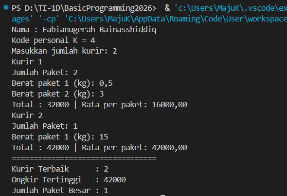

# QUIZ 2 PRAKTIK - PERULANGAN BERSARANG (OPSI C)

**Identitas Mahasiswa:**

- **Nama:** Fabianugerah Bainasshiddiq
- **NIM:** 264107020026
- **Kelas / No. Presensi:** 1D / 14

---

## 1: SOAL

### Rekap Ongkir Kurir Paket

Agen ekspedisi merekap ongkos kirim yang dihasilkan setiap kurir dalam satu hari. **Jumlah paket berbeda untuk setiap kurir.**

**Ketentuan umum:**

- Program ditulis dalam satu file Java bernama `Quiz2NoAbsen.java` (nama class sama dengan nama file).
- Di awal `main()` wajib ada variabel `nama`, `noAbsen`, dan `k = noAbsen % 5`. Dua baris pertama output adalah nama dan kode personal K.
- Jenis perulangan di setiap tingkat wajib sesuai soal, dan semua input dianggap selalu valid.
- Boleh dipakai: `int`, `double`, `String`, operator, `Scanner`, `if / else if / else`, `for`, `while`, `do-while`, `break`, dan `print / println / printf`. Tidak boleh dipakai: array, method selain `main`, `try-catch`, kelas `Math`, operator ternary, `switch`, dan library selain `Scanner`.
- Rata-rata dicetak dengan 2 angka desimal (`%.2f`).
- Tulis satu baris komentar tepat di atas outer loop yang menjawab: _"Berapa kali badan inner loop dijalankan untuk contoh ilustrasi pada soal ini?"_

**Ketentuan program:**

1. Masukkan jumlah kurir.
2. Untuk setiap kurir, masukkan jumlah paket (boleh 0). Jumlah ini menjadi batas inner loop.
3. Untuk setiap paket, masukkan berat (kg, desimal) dengan tarif per paket:

   | Berat Paket | Tarif | Keterangan |
   | :-: | :-: | :-: |
   | <= 1 kg | Rp8.000 | - |
   | <= 10 kg | Rp20.000 | - |
   | selain itu | Rp40.000 | dihitung sebagai **paket besar** |

4. Setiap paket ditambah biaya admin **K x 500** rupiah.
5. Per kurir, tampilkan total ongkir dan rata-rata ongkir per paket. Jika jumlah paket = 0, rata-rata = 0.
6. Ringkasan akhir: kurir terbaik (total ongkir tertinggi; jika seri, nomor terkecil), ongkir tertinggi, dan jumlah paket besar.

**Jenis perulangan yang wajib:**

| Tingkat Perulangan | Jenis Loop Wajib |
| :-: | :-: |
| Kurir (outer) | `while` |
| Paket (inner) | `for`, batas dari input |

**Contoh ilustrasi (K = 0):**

```
Nama : Andi Pratama
Kode personal K = 0
Jumlah kurir : 2
Kurir 1
  Jumlah paket: 2
    Berat paket 1 (kg): 0.5
    Berat paket 2 (kg): 3
  Total: 28000 | Rata per paket: 14000.00
Kurir 2
  Jumlah paket: 1
    Berat paket 1 (kg): 15
  Total: 40000 | Rata per paket: 40000.00
=================================
Kurir terbaik       : 2
Ongkir tertinggi    : 40000
Jumlah paket besar  : 1
```

---

## 2: HASIL PENGERJAAN & ANALISIS

### 2.1 Kode Program Java

```java
import java.util.Scanner;

public class Quiz214 {
    public static void main(String[] args) {
        Scanner sc = new Scanner(System.in);

        String nama = "Fabianugerah Bainasshiddiq";
        int noAbsen = 14;
        int k = noAbsen % 5;
        System.out.println("Nama : " + nama);
        System.out.println("Kode personal K = " + k);

        // Batas identitas

        System.out.print("Masukkan jumlah kurir: ");
        int jumlahKurir = sc.nextInt();

        int kurir = 1;
        int kurirTerbaik = 0;
        int ongkirTertinggi = -1;
        int jumlahPaketBesar = 0;

        while (kurir <= jumlahKurir) {
            System.out.println("Kurir " + kurir);
            System.out.print("Jumlah Paket: ");
            int jumlahPaket = sc.nextInt();

            int total = 0;

            for (int i = 1;i <= jumlahPaket;i++) {
                System.out.print("Berat paket " + i + " (kg): ");
                double berat = sc.nextDouble();

                int tarif;
                if (berat <= 1) {
                    tarif = 8000;
                } else if (berat <= 10) {
                    tarif = 20000;
                } else {
                    tarif = 40000;
                    jumlahPaketBesar++;
                }

                total = total + tarif + (k * 500);
            }

            double rata = 0;
            if (jumlahPaket > 0) {
                rata = (double) total / jumlahPaket;
            }

            System.out.printf("Total : %d | Rata per paket: %.2f%n", total, rata);

            if (total > ongkirTertinggi) {
                ongkirTertinggi = total;
                kurirTerbaik = kurir;
            }

            kurir++;            
        }

        if (ongkirTertinggi < 0) {
            ongkirTertinggi = 0;
        }

        System.out.println("=================================");
        System.out.println("Kurir Terbaik      : " + kurirTerbaik);
        System.out.println("Ongkir Tertinggi   : " + ongkirTertinggi);
        System.out.println("Jumlah Paket Besar : " + jumlahPaketBesar);

        sc.close();
    }
}
```

### 2.2 Hasil Running / Screenshot Output



### 2.3 Penjelasan Program

- **Identitas dan kode personal:** `k = noAbsen % 5` menghasilkan `14 % 5 = 4`, sehingga biaya admin per paket adalah `k * 500 = 2000`. Nilai ini membuat output berbeda dari contoh ilustrasi (K = 0).
- **Perulangan bersarang:** outer loop `while (kurir <= jumlahKurir)` memproses setiap kurir, dan inner loop `for (int i = 1; i <= jumlahPaket; i++)` memproses setiap paket milik kurir tersebut. Variabel `total` dideklarasikan di dalam outer loop sehingga di-reset ke 0 untuk setiap kurir.
- **Seleksi tarif:** `if / else if / else` memeriksa berat dari batas terkecil: `<= 1` Rp8.000, `<= 10` Rp20.000, selain itu Rp40.000 sekaligus menambah `jumlahPaketBesar`. Urutan cabang ini membuat berat tepat 1 kg dan 10 kg masuk ke tarif yang lebih murah.
- **Rata-rata:** `rata` bertipe `double` dan dihitung dengan casting `(double) total / jumlahPaket` agar tidak terjadi pembagian bilangan bulat. Jika `jumlahPaket = 0`, rata-rata dibiarkan 0.
- **Kurir terbaik:** `ongkirTertinggi` diawali `-1` agar kurir dengan total 0 tetap bisa menjadi kurir terbaik pertama. Perbandingan memakai `>` (bukan `>=`) sehingga jika ada total yang seri, kurir dengan nomor terkecil tetap dipertahankan. Jika tidak ada kurir (`jumlahKurir = 0`), `ongkirTertinggi` yang masih `-1` diubah menjadi 0.
- **Jumlah putaran inner loop pada contoh ilustrasi:** badan inner loop dijalankan **3 kali** (2 paket untuk Kurir 1 ditambah 1 paket untuk Kurir 2).

---

## 3: KESIMPULAN

Program berhasil merekap ongkir kurir paket dengan perulangan bersarang, yaitu `while` untuk kurir dan `for` untuk paket. Seleksi kondisi dipakai untuk menentukan tarif berdasarkan berat, `double` dan casting dipakai untuk rata-rata, dan variabel penampung dengan nilai awal serta posisi reset yang tepat dipakai untuk menentukan kurir terbaik beserta kasus khususnya (kurir tanpa paket, total seri, dan tanpa kurir).
