# JOBSHEET 9 - ARRAY 1 DIMENSI

**Identitas Mahasiswa:**

- **Nama:** Fabianugerah Bainasshiddiq
- **NIM:** 264107020026
- **Kelas / No. Presensi:** 1D / 14

---

## 1: TUJUAN PRAKTIKUM

Berikut adalah tujuan pelaksanaan praktikum pada bab ini:

1. Mahasiswa mampu memahami konsep array 1 dimensi serta cara mendeklarasikan, menginisialisasi, dan mengakses elemennya dalam bahasa pemrograman Java.
2. Mahasiswa mampu membuat program yang memanfaatkan array 1 dimensi untuk menyimpan dan mengolah data, termasuk menggunakan perulangan `for` dan `foreach`.
3. Mahasiswa mampu menerapkan operasi aritmatika pada elemen array, seperti menghitung total, rata-rata, nilai tertinggi, dan nilai terendah.
4. Mahasiswa mampu menerapkan algoritma pencarian (searching) dan pengurutan (sorting) sederhana pada array 1 dimensi.
5. Mahasiswa mampu menerapkan array 1 dimensi untuk menyelesaikan studi kasus yang relevan dengan kehidupan kampus dan sehari-hari.

---

## 2: HASIL PERCOBAAN & ANALISIS

### 2.1 Percobaan 1: Deklarasi, Inisialisasi, Mengisi, dan Menampilkan Elemen Array

Pada percobaan ini dibuat array `bil` bertipe `int` berkapasitas 4 elemen, diisi satu per satu, lalu ditampilkan dengan tiga cara: perulangan `for`, `foreach`, dan `Arrays.toString()`. Kode juga memuat modifikasi pada Pertanyaan 2 (inisialisasi saat deklarasi) dan Pertanyaan 3 (menampilkan nilai dikali 2).

#### 2.1.1 Kode Program Java

```java
import java.util.Arrays;

public class ArrayBilangan14 {
    public static void main(String[] args) {
        int[] bil = new int[4];

        bil[0] = 5;
        bil[1] = 13;
        bil[2] = -7;
        bil[3] = 17;

        for (int i = 0; i < bil.length; i++) {
            System.out.println("bil[" + i + "] = " + bil[i]);
        }

        for (int nilai : bil) {
            System.out.println(nilai);
        }
        System.out.println(Arrays.toString(bil));

        // Modifikasi Code Pertanyaan 2: inisialisasi langsung saat deklarasi
        System.out.println();
        System.out.println("Pertanyaan 2: inisialisasi saat deklarasi");
        int[] bilLangsung = {5, 13, -7, 17};
        System.out.println(Arrays.toString(bilLangsung));

        // Modifikasi Code Pertanyaan 3: tampilkan juga nilai dikali 2
        System.out.println();
        System.out.println("Pertanyaan 3: tampilkan nilai dan double");
        for (int i = 0; i < bil.length; i++) {
            System.out.println("bil[" + i + "] = " + bil[i] + ", double = " + (bil[i] * 2));
        }
    }
}
```

#### 2.1.2 Hasil Running / Screenshot Output

Berikut adalah tampilan _output_ setelah program dijalankan:

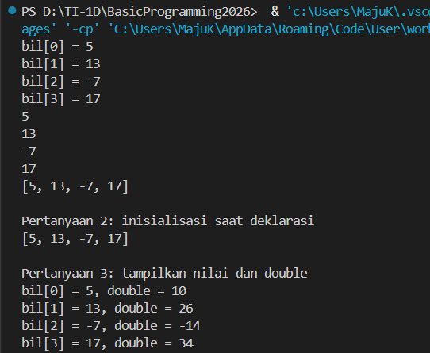

#### 2.1.3 Jawaban Pertanyaan / Pertanyaan Refleksi

- **Pertanyaan 1:** Jika isi masing-masing elemen array `bil` diubah dengan angka `5.0`, `12867`, `7.5`, `2000000`, apa yang terjadi? Mengapa bisa demikian?
  - **Jawab:** Program gagal di-compile dengan pesan `incompatible types: possible lossy conversion from double to int`. Karena array `bil` bertipe `int`, sehingga hanya dapat menampung bilangan bulat atau integer. Nilai `12867` dan `2000000` masih bisa dimuat dalam `int`, tetapi untuk nilai `5.0` dan `7.5` bertipe `double` (desimal) sehingga tidak bisa dimasukkan ke `int`. Agar semua nilai dapat disimpan, tipe array harus diubah menjadi `double[]`.

- **Pertanyaan 2:** Modifikasi kode program di atas dengan melakukan inisialisasi elemen array sekaligus pada saat deklarasi array (tanpa new `int[4]` dan pengisian satu per satu).
  - **Jawab:** Cukup ditulis `int[] bilLangsung = {5, 13, -7, 17};`. Ukuran array otomatis mengikuti banyaknya nilai yang dituliskan, yaitu 4.

- **Pertanyaan 3:** Ubah statement penampilan pada langkah ke-4 menjadi seperti berikut: `System.out.println("bil[" + i + "] = " + bil[i] + ", double = " + (bil[i] * 2));` Apa keluaran dari program? Jelaskan maksud dari statement tersebut.
  - **Jawab:**
  **Output program:**

    ```
    bil[0] = 5, double = 10
    bil[1] = 13, double = 26
    bil[2] = -7, double = -14
    bil[3] = 17, double = 34
    ```

    **Penjelasan:**
    Statement ini menampilkan nilai elemen ke-`i` beserta dua kali lipatnya. Kata `double` pada teks hanya berupa tulisan yang berarti "dua kali", bukan tipe data `double`. Ekspresi `(bil[i] * 2)` dihitung terlebih dahulu, lalu hasilnya digabungkan ke string dengan operator `+`.

- **Pertanyaan 4:** Jika kondisi pada statement for-loop di atas diubah menjadi `i <= 4`, apa keluaran dari program? Mengapa demikian?
  - **Jawab:** Program menampilkan `bil[0]` sampai `bil[3]`, lalu berhenti dengan error `ArrayIndexOutOfBoundsException: Index 4 out of bounds for length 4`. Karena array berkapasitas 4 elemen hanya memiliki indeks valid 0 sampai 3, sedangkan kondisi `i <= 4` membuat perulangan mencoba mengakses `bil[4]` sedangkan untuk nilai `bil[4]` tidak ada.

- **Pertanyaan 5:** Apa perbedaan antara menampilkan array menggunakan `for loop`, `foreach loop`, dan `Arrays.toString()` pada langkah ke-5? Kapan sebaiknya masing-masing digunakan?
  - **Jawab:**
    - **`for loop`:** memakai indeks `i`, sehingga fleksibel untuk mengakses, mengubah, atau membandingkan elemen (misalnya `arr[i]` dengan `arr[i+1]`). Dipakai ketika indeks atau perubahan isi array diperlukan.
    - **`foreach loop`:** lebih ringkas, tetapi tidak mengetahui indeks dan tidak dapat mengubah isi array. Dipakai untuk sekadar membaca atau menampilkan semua elemen.
    - **`Arrays.toString()`:** menampilkan seluruh isi array dalam satu baris berformat `[5, 13, -7, 17]` tanpa perulangan manual. Dipakai untuk melihat isi array dengan cepat, misalnya saat debugging.

---

### 2.2 Percobaan 2: Studi Kasus SIAKAD - Input Nilai Mahasiswa dan Status Kelulusan

Pada percobaan ini dosen menginput nilai akhir 10 mahasiswa ke dalam array `nilaiAkhir`, lalu program menampilkan nilai beserta status kelulusan (LULUS jika nilai lebih dari 70, selain itu TIDAK LULUS). Kode juga memuat modifikasi pada Pertanyaan 2, 3, dan 4.

#### 2.2.1 Kode Program Java

```java
import java.util.Scanner;

public class ArrayNilai14 {
    public static void main(String[] args) {
        Scanner input = new Scanner(System.in);

        int[] nilaiAkhir = new int[10];

        for (int i = 0; i < nilaiAkhir.length; i++) {
            System.out.print("Masukkan nilai mahasiswa ke-" + (i + 1) + ": ");
            nilaiAkhir[i] = input.nextInt();
        }

        for (int i = 0; i < nilaiAkhir.length; i++) {
            String status = (nilaiAkhir[i] > 70) ? "LULUS" : "TIDAK LULUS";
            System.out.println("Mahasiswa ke-" + (i + 1) + ": " + nilaiAkhir[i] + " (" + status + ")");
        }

        // Modifikasi Code Pertanyaan 2: Hanya tampilkan mahasiswa yang lulus
        System.out.println();
        System.out.println("Pertanyaan 2: Mahasiswa yang lulus (nilai > 70)");
        for (int i = 0; i < nilaiAkhir.length; i++) {
            if (nilaiAkhir[i] > 70) {
                System.out.println("Mahasiswa ke-" + (i + 1) + ": " + nilaiAkhir[i]);
            }
        }

        // Modifikasi Code Pertanyaan 3: Menampilkan dengan foreach
        System.out.println();
        System.out.println("Pertanyaan 3: Tampilan dengan foreach");
        int nomor = 1;
        for (int nilai : nilaiAkhir) {
            String status = (nilai > 70) ? "LULUS" : "TIDAK LULUS";
            System.out.println("Mahasiswa ke-" + nomor + ": " + nilai + " (" + status + ")");
            nomor++;
        }

        // Modifikasi Code Pertanyaan 4: Jumlah lulus dan tidak lulus
        int jumlahLulus = 0;
        int jumlahTidakLulus = 0;
        for (int nilai : nilaiAkhir) {
            if (nilai > 70) {
                jumlahLulus++;
            } else {
                jumlahTidakLulus++;
            }
        }
        System.out.println();
        System.out.println("Pertanyaan 4: Rekap kelulusan");
        System.out.println("Jumlah mahasiswa lulus : " + jumlahLulus);
        System.out.println("Jumlah mahasiswa tidak lulus : " + jumlahTidakLulus);

        input.close();
    }
}
```

#### 2.2.2 Hasil Running / Screenshot Output

Berikut adalah tampilan _output_ setelah program dijalankan:

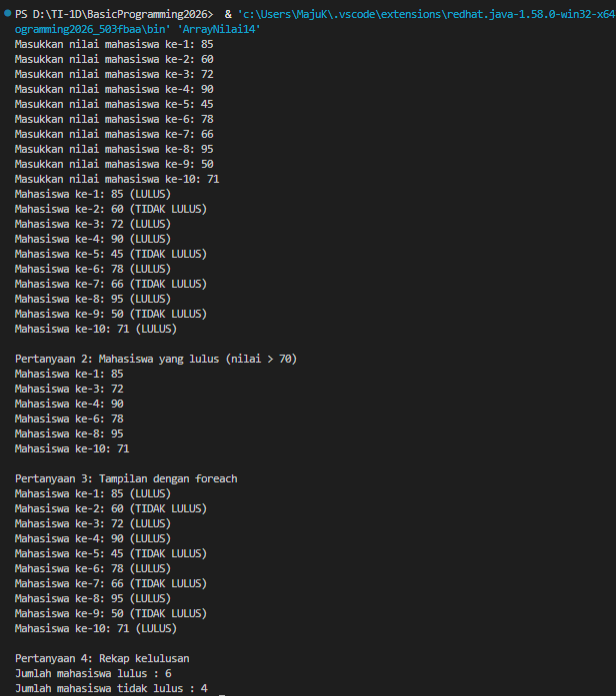

#### 2.2.3 Jawaban Pertanyaan / Pertanyaan Refleksi

- **Pertanyaan 1:** Apa yang dimaksud dengan kondisi `i < nilaiAkhir.length` pada perulangan di atas?
  - **Jawab:** `nilaiAkhir.length` adalah banyaknya elemen array (10). Karena indeks dimulai dari 0, indeks valid adalah 0 sampai 9. Kondisi `i < nilaiAkhir.length` membuat perulangan berjalan selama `i` masih berada pada indeks yang valid dan berhenti saat `i = 10`, sehingga program tidak mengakses indeks di luar array.

- **Pertanyaan 2:** Modifikasi program agar hanya menampilkan nilai mahasiswa yang lulus saja `(nilai > 70)`, tanpa menampilkan yang tidak lulus. Jelaskan alur programnya!
  - **Jawab:** Perulangan `for` menelusuri seluruh elemen array. Di dalamnya, `if (nilaiAkhir[i] > 70)` memeriksa setiap nilai. Jika benar, nomor mahasiswa dan nilainya ditampilkan, jika tidak maka tidak ada yang ditampilkan dan perulangan lanjut ke elemen berikutnya.

- **Pertanyaan 3:** Ubah perulangan pada langkah ke-4 dan ke-5 dari `for loop` menjadi `foreach loop`. Apakah seluruh bagian program dapat diubah menjadi `foreach`? Jelaskan bagian mana yang bisa dan tidak bisa, beserta alasannya.
  - **Jawab:**
    - **Langkah 5 (menampilkan) bisa** diubah menjadi `for (int nilai : nilaiAkhir)` karena hanya membaca nilai. Nomor mahasiswa harus dihitung dengan variabel pencacah (`nomor++`) karena foreach tidak punya indeks.
    - **Langkah 4 (input) tidak bisa** diubah menjadi foreach. Variabel foreach hanyalah salinan nilai elemen, sehingga `nilai = input.nextInt()` tidak mengubah isi array dan elemen tetap bernilai 0.

- **Pertanyaan 4:** Modifikasi program agar turut menghitung dan menampilkan jumlah mahasiswa yang lulus dan jumlah mahasiswa yang tidak lulus di akhir program.
  - **Jawab:** Ditambahkan variabel `jumlahLulus` dan `jumlahTidakLulus` bernilai awal 0. Pada setiap elemen, jika nilai > 70 maka `jumlahLulus++`, selain itu `jumlahTidakLulus++`. Hasilnya ditampilkan setelah perulangan selesai.

---

### 2.3 Percobaan 3: Operasi Aritmatika pada Array - Total, Rata-rata, Nilai Tertinggi dan Terendah

Percobaan ini melanjutkan studi kasus SIAKAD untuk menghasilkan ringkasan nilai mahasiswa, sebagaimana biasa ditampilkan pada rekap nilai akhir semester. Kode juga memuat modifikasi Pertanyaan 1 (jumlah mahasiswa lulus).

#### 2.3.1 Kode Program Java

```java
import java.util.Scanner;

public class ArrayRataNilai14 {
    public static void main(String[] args) {
        Scanner input = new Scanner(System.in);

        int[] nilaiMhs = new int[10];
        int total = 0;
        double rata2;

        for (int i = 0; i < nilaiMhs.length; i++) {
            System.out.print("Masukkan nilai mahasiswa ke-" + (i + 1) + ": ");
            nilaiMhs[i] = input.nextInt();
            total += nilaiMhs[i];
        }

        rata2 = (double) total / nilaiMhs.length;
        System.out.println("Total nilai: " + total);
        System.out.println("Rata-rata: " + rata2);

        int tertinggi = nilaiMhs[0];
        int terendah = nilaiMhs[0];
        for (int i = 1; i < nilaiMhs.length; i++) {
            if (nilaiMhs[i] > tertinggi) tertinggi = nilaiMhs[i];
            if (nilaiMhs[i] < terendah) terendah = nilaiMhs[i];
        }
        System.out.println("Nilai tertinggi: " + tertinggi);
        System.out.println("Nilai terendah: " + terendah);

        String predikat;
        if (rata2 >= 85) {
            predikat = "SANGAT BAIK";
        } else if (rata2 >= 70) {
            predikat = "BAIK";
        } else {
            predikat = "PERLU PENDAMPINGAN";
        }
        System.out.println("Predikat kelas: " + predikat);

        // Modifikasi Code Pertanyaan 1: Banyaknya mahasiswa yang lulus (nilai > 70)
        int jumlahLulus = 0;
        for (int i = 0; i < nilaiMhs.length; i++) {
            if (nilaiMhs[i] > 70) {
                jumlahLulus++;
            }
        }
        System.out.println("Jumlah mahasiswa lulus (> 70): " + jumlahLulus);

        input.close();
    }
}
```

#### 2.3.2 Hasil Running / Screenshot Output

Berikut adalah tampilan _output_ setelah program dijalankan:

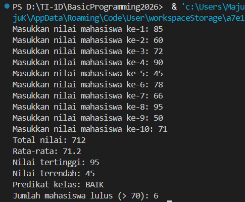

#### 2.3.3 Jawaban Pertanyaan / Pertanyaan Refleksi

- **Pertanyaan 1:** Modifikasi kode program di atas agar dapat menampilkan banyaknya mahasiswa yang lulus, yaitu mahasiswa yang memiliki nilai lebih besar dari 70 (> 70).
  - **Jawab:** Ditambahkan variabel `jumlahLulus` bernilai awal 0, lalu perulangan `for` dengan `if (nilaiMhs[i] > 70) { jumlahLulus++; }`. Untuk data uji 1 hasilnya adalah 6 mahasiswa.

- **Pertanyaan 2:** Modifikasi program di atas sehingga program menerima jumlah elemen array berdasarkan input dari pengguna (tidak selalu 10), lalu tetap dapat menghitung total, rata-rata, nilai tertinggi, dan nilai terendah dengan benar.
  - **Jawab:** Jumlah mahasiswa dibaca terlebih dahulu ke variabel `jumlah`, lalu array dibuat dengan `new int[jumlah]`. Seluruh perulangan memakai `nilaiMhs.length` sebagai batas (bukan angka 10), sehingga perhitungan tetap benar berapa pun ukurannya.

  **Kode Program:**
  **ArrayRataNilaiDinamis14.java:**

    ```java
    import java.util.Scanner;

    public class ArrayRataNilaiDinamis14 {
        public static void main(String[] args) {
            Scanner input = new Scanner(System.in);

            System.out.print("Masukkan jumlah mahasiswa: ");
            int jumlah = input.nextInt();

            int[] nilaiMhs = new int[jumlah];
            int total = 0;

            for (int i = 0; i < nilaiMhs.length; i++) {
                System.out.print("Masukkan nilai mahasiswa ke-" + (i + 1) + ": ");
                nilaiMhs[i] = input.nextInt();
                total += nilaiMhs[i];
            }

            double rata2 = (double) total / nilaiMhs.length;

            int tertinggi = nilaiMhs[0];
            int terendah = nilaiMhs[0];
            for (int i = 1; i < nilaiMhs.length; i++) {
                if (nilaiMhs[i] > tertinggi) tertinggi = nilaiMhs[i];
                if (nilaiMhs[i] < terendah) terendah = nilaiMhs[i];
            }

            System.out.println("Total nilai: " + total);
            System.out.println("Rata-rata: " + rata2);
            System.out.println("Nilai tertinggi: " + tertinggi);
            System.out.println("Nilai terendah: " + terendah);

            input.close();
        }
    }
    ```

    **Output Program:**

    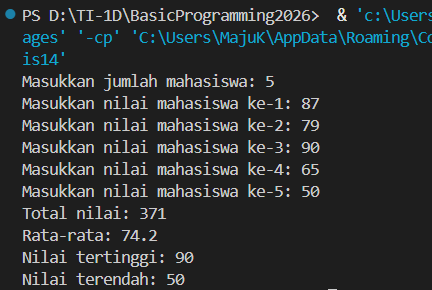

- **Pertanyaan 3:** Mengapa pada perhitungan rata-rata digunakan `(double) total / nilaiMhs.length`, bukan langsung `total / nilaiMhs.length`? Jelaskan!
  - **Jawab:** Karena `total` dan `nilaiMhs.length` sama-sama bertipe `int`, sehingga `total / nilaiMhs.length` adalah pembagian bilangan bulat yang membuang bagian desimal. Jadi nanti saat dibagi yang seharusnya ada nilai desimal jadinya tidak ada desimalnya karena nilai bertipe `int` atau bilangan bulat dan harus dicasting ke nilai `double` (desimal) terlebih dahulu agar hasil akhirnya sesuai dengan hasil pembagiannya.

---

### 2.4 Percobaan 4: Pencarian (Searching) dan Pengurutan (Sorting) Sederhana

Percobaan ini menerapkan algoritma pencarian dan pengurutan sederhana pada data nilai mahasiswa, dua kemampuan dasar yang banyak dipakai dalam pengolahan data nyata.

#### 2.4.1 Kode Program Java

**SearchNilai14.java** (Bagian A - Linear Search)

```java
public class SearchNilai14 {
    public static void main(String[] args) {

        int[] nilai = { 78, 65, 90, 55, 88, 72 };
        int key = 100;
        boolean ditemukan = false;

        for (int i = 0; i < nilai.length; i++) {
            if (nilai[i] == key) {
                System.out.println("Nilai " + key + " ditemukan pada indeks ke-" + i);
                ditemukan = true;
                break;
            }
        }
        if (!ditemukan) {
            System.out.println("Nilai " + key + " tidak ditemukan.");
        }
    }
}
```

**SortNilai14.java** (Bagian B - Bubble Sort)

```java
import java.util.Arrays;

public class SortNilai14 {
    public static void main(String[] args) {
        int[] nilai = { 78, 65, 90, 55, 88, 72 };
        for (int i = 0; i < nilai.length - 1; i++) {
            for (int j = 0; j < nilai.length - 1 - i; j++) {
                if (nilai[j] > nilai[j + 1]) {
                    int temp = nilai[j];
                    nilai[j] = nilai[j + 1];
                    nilai[j + 1] = temp;
                }
            }
        }
        System.out.println(Arrays.toString(nilai));
    }
}
```

#### 2.4.2 Hasil Running / Screenshot Output

Berikut adalah tampilan _output_ setelah program dijalankan:

**SearchNilai14.java** (Bagian A - Linear Search)
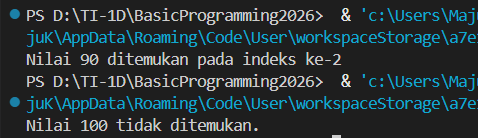

**SortNilai14.java** (Bagian B - Bubble Sort)
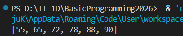

#### 2.4.3 Jawaban Pertanyaan / Pertanyaan Refleksi

- **Pertanyaan 1:** Jelaskan maksud dari statement `break;` pada kode program Bagian A di atas!
  - **Jawab:** `break;` menghentikan perulangan `for` seketika saat nilai yang dicari sudah ditemukan. Elemen sisanya tidak perlu diperiksa lagi, sehingga pencarian lebih efisien dan program hanya menampilkan indeks kemunculan pertama. Tanpa `break`, perulangan tetap berjalan sampai elemen terakhir dan akan menampilkan setiap kemunculan key.

- **Pertanyaan 2:** Modifikasi kode program Bagian A sehingga program dapat menerima input berupa banyaknya elemen array nilai, isi array, dan sebuah nilai `(key)` yang ingin dicari dari pengguna, lalu mencetak indeks posisi elemen dari nilai `(key)` tersebut.
  - **Jawab:**
  **Kode Program:**
  **SearchNilaiInput14:**

    ```java
    import java.util.Scanner;

    public class SearchNilaiInput14 {
        public static void main(String[] args) {
            Scanner input = new Scanner(System.in);

            System.out.print("Masukkan banyaknya elemen array: ");
            int jumlah = input.nextInt();

            int[] nilai = new int[jumlah];
            for (int i = 0; i < nilai.length; i++) {
                System.out.print("Masukkan elemen ke-" + (i + 1) + ":");
                nilai[i] = input.nextInt();
            }

            System.out.print("Masukkan nilai yang dicari (key): ");
            int key = input.nextInt();

            for (int i = 0; i < nilai.length; i++) {
                if (nilai[i] == key) {
                    System.out.println("Nilai " + key + " ditemukanpada indeks ke-" + i);
                    break;
                }
            }

            input.close();
        }
    }
    ```

    **Output Program:**

    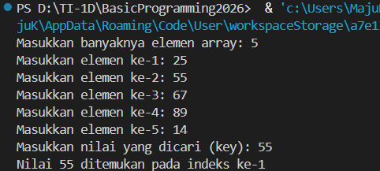

- **Pertanyaan 3:** Modifikasi program Bagian A agar menampilkan pesan `"Nilai yang dicari tidak ditemukan"` dengan format pesan yang lebih informatif apabila nilai yang dicari `(key)` tidak ada di dalam array.
  - **Jawab:**
  **Kode Program:**
  **SearchNilaiInput14:**

    ```java
    import java.util.Arrays;
    import java.util.Scanner;

    public class SearchNilaiInput14 {
        public static void main(String[] args) {
            Scanner input = new Scanner(System.in);

            System.out.print("Masukkan banyaknya elemen array: ");
            int jumlah = input.nextInt();

            int[] nilai = new int[jumlah];
            for (int i = 0; i < nilai.length; i++) {
                System.out.print("Masukkan elemen ke-" + (i + 1) + ": ");
                nilai[i] = input.nextInt();
            }

            System.out.print("Masukkan nilai yang dicari (key): ");
            int key = input.nextInt();

            boolean ditemukan = false;
            for (int i = 0; i < nilai.length; i++) {
                if (nilai[i] == key) {
                    System.out.println("Nilai " + key + " ditemukan pada indeks ke-" + i);
                    ditemukan = true;
                    break;
                }
            }

            if (!ditemukan) {
                System.out.println("Nilai yang dicari tidak ditemukan: nilai " + key
                        + " tidak ada di dalam array " + Arrays.toString(nilai));
            }

            input.close();
        }
    }
    ```

    **Output Program:**

    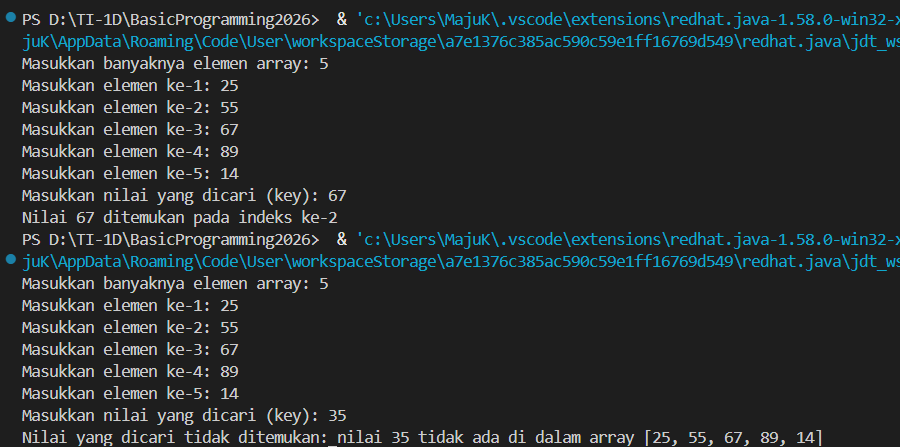

- **Pertanyaan 4:** Jelaskan langkah demi langkah cara kerja algoritma bubble sort pada Bagian B menggunakan data ujicoba yang tersedia!
  - **Jawab:** Bubble sort membandingkan dua elemen bersebelahan (`nilai[j]` dan `nilai[j + 1]`) dan menukarnya jika urutannya salah (kiri lebih besar dari kanan). Perulangan luar (`i`) menentukan banyaknya putaran (`panjang - 1`), sedangkan perulangan dalam (`j`) melakukan perbandingan, dengan batas `panjang - 1 - i` karena `i` elemen terbesar di ujung kanan sudah berada di posisi akhir.
  Pada data `{78, 65, 90, 55, 88, 72}`:

    | Putaran (i) | Proses Perbandingan dan Penukaran | Isi Array Setelah Putaran |
    | :-: | :-- | :-: |
    | 0 | 78>65 tukar; 78>90 tidak; 90>55 tukar; 90>88 tukar; 90>72 tukar | [65, 78, 55, 88, 72, 90] |
    | 1 | 65>78 tidak; 78>55 tukar; 78>88 tidak; 88>72 tukar | [65, 55, 78, 72, 88, 90] |
    | 2 | 65>55 tukar; 65>78 tidak; 78>72 tukar | [55, 65, 72, 78, 88, 90] |
    | 3 | 55>65 tidak; 65>72 tidak | [55, 65, 72, 78, 88, 90] |
    | 4 | 55>65 tidak | [55, 65, 72, 78, 88, 90] |

    Setelah putaran terakhir, array terurut menaik: `[55, 65, 72, 78, 88, 90]`. Proses penukaran ini memakai variabel sementara yaitu `temp` agar nilai tidak hilang.

- **Pertanyaan 5:** Modifikasi program Bagian B agar mengurutkan array dari nilai terbesar ke terkecil (descending), bukan dari terkecil ke terbesar.
  - **Jawab:**
  **Kode Program:**
  **SearchNilaiInput14:**

    ```java
    import java.util.Arrays;

    public class SortNilaiDesc14 {
        public static void main(String[] args) {
            int[] nilai = {78, 65, 90, 55, 88, 72};

            System.out.println("Mengurutkan dari nilai terkecil ke terbesar: " + Arrays.toString(nilai));

            for (int i = 0; i < nilai.length - 1; i++) {
                for (int j = 0; j < nilai.length - 1 - i; j++) {
                    if (nilai[j] < nilai[j + 1]) {   // tanda dibalik dari > menjadi <
                        int temp = nilai[j];
                        nilai[j] = nilai[j + 1];
                        nilai[j + 1] = temp;
                    }
                }
            }

            System.out.println("Mengurutkan dari nilai terbesar ke terkecil: " + Arrays.toString(nilai));
        }
    }
    ```

    **Output Program:**

    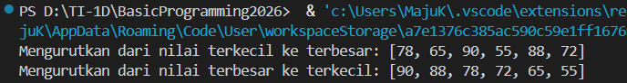

---

## 4: TUGAS MANDIRI

Berikut adalah daftar tugas yang dikerjakan pada Jobsheet ini:

- [x] **Tugas 1:** Buatlah program yang dapat menyimpan dan mengelola nilai mahasiswa (bilangan bulat). Program harus menyediakan fitur untuk:
  - Memasukkan banyaknya nilai mahasiswa yang akan diinput.
  - Memasukkan setiap nilai mahasiswa satu per satu.
  - Menghitung nilai rata-rata dari seluruh nilai yang dimasukkan.
  - Menampilkan nilai tertinggi dan nilai terendah.
  - Menampilkan semua nilai yang telah dimasukkan, beserta status kelulusannya (LULUS / TIDAK LULUS).

- [x] **Tugas 2:** Buat program yang dapat mengelola pemesanan makanan dan minuman di kafe kampus. Program menyediakan daftar menu yang sudah ditentukan, memungkinkan pengguna memilih menu melalui fitur pencarian, mencatat pesanan, serta menghitung total biaya.

### 4.1 Tugas 1: Pengelolaan Nilai Mahasiswa

Program membaca banyaknya nilai, mengisi array `nilai` dan mengakumulasi total dalam satu perulangan, lalu menghitung rata-rata dengan casting `double`. Nilai tertinggi dan terendah dicari dengan variabel pembanding, dan seluruh nilai ditampilkan dengan status kelulusan (LULUS jika nilai > 70).

#### 4.1.1 Kode Program Java

```java
import java.util.Scanner;

public class Tugas1NilaiMahasiswa14 {
    public static void main(String[] args) {
        Scanner sc = new Scanner(System.in);

        System.out.println("Masukkan banyaknya nilai mahasiswa: ");
        int jumlah = sc.nextInt();

        int[] nilai = new int[jumlah];
        int total = 0;

        for (int i = 0; i < nilai.length; i++) {
            System.out.println("Masukkan nilai mahasiswa ke-" + (i + 1) + ":");
            nilai[i] = sc.nextInt();
            total += nilai[i];
        }

        double rata2 = (double) total / nilai.length;

        int tertinggi = nilai[0];
        int terendah = nilai[0];
        for (int i = 1; i < nilai.length; i++) {
            if (nilai[i] > tertinggi) tertinggi = nilai[i];
            if (nilai[i] < terendah) terendah = nilai[i];
        }
        System.out.println();

        System.out.println("Daftar Nilai Mahasiswa");
        for (int i = 0; i < nilai.length; i++) {
            String status = (nilai[i] > 70) ? "LULUS" : "TIDAK LULUS";
            System.out.println("Mahasiswa ke-" + (i + 1) + ": " + nilai[i] + " (" + status + ")");
        }

        System.out.println("==================================");
        System.out.printf("Rata-rata nilai : %.2f%n", rata2);
        System.out.println("Nilai tertinggi : " + tertinggi);
        System.out.println("Nilai terendah : " + terendah);

        sc.close();
    }
}
```

#### 4.1.2 Tabel Pengujian Parameter Output

| Uji | Data Nilai | Rata-rata | Tertinggi | Terendah | Status Eksekusi |
| :-: | :-: | :-: | :-: | :-: | :-: |
| 1 | 85, 60, 72, 45, 95 | 71.40 | 95 | 45 | 85 LULUS, 60 TIDAK LULUS, 72 LULUS, 45 TIDAK LULUS, 95 LULUS |
| 2 | 70, 71, 100 | 80.33 | 100 | 70 | 70 TIDAK LULUS, 71 LULUS, 100 LULUS |

#### 4.1.3 Hasil Running / Screenshot Output

Berikut adalah tampilan _output_ setelah program dijalankan:

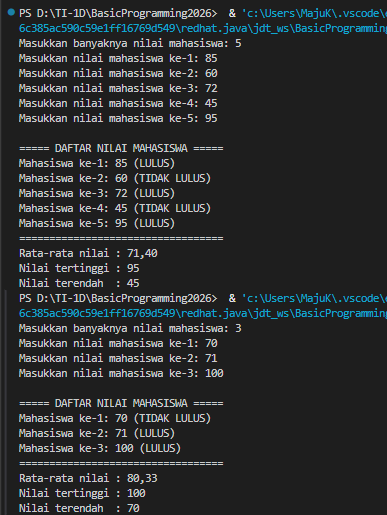

### 4.2 Tugas 2: Aplikasi Pemesanan Kafe Kampus

Program menyediakan menu berulang: melihat daftar menu, mencari menu, membuat pesanan, dan keluar. Pencarian memakai linear search pada array `menu` dan tidak membedakan huruf besar/kecil. Pada pemesanan, nama menu yang dimasukkan harus ada di daftar menu (jika tidak, diminta ulang), lalu nama dan harga pesanan disimpan pada array `pesanan` dan `hargaPesanan` yang terpisah dari array `menu`. Total biaya dihitung dan daftar pesanan ditampilkan dalam format tabel.

#### 4.2.1 Kode Program Java

```java
import java.util.Scanner;

public class Tugas2KafeKampus14 {
    public static void main(String[] args) {
        Scanner sc = new Scanner(System.in);

        String[] menu = { "Nasi Goreng", "Mie Goreng", "Roti Bakar", "Kentang Goreng", "Teh Tarik", "Cappucino",
                "Chocolate Ice" };
        int[] harga = { 15000, 13000, 10000, 12000, 8000, 18000, 20000 };

        String[] pesanan = new String[0];
        int[] hargaPesanan = new int[0];
        int totalBiaya = 0;

        int pilihan;
        do {
            System.out.println();
            System.out.println("==== KAFE KAMPUS ====");
            System.out.println("1. Lihat daftar menu");
            System.out.println("2. Cari menu");
            System.out.println("3. Buat pesanan");
            System.out.println("0. Keluar");
            System.out.print("Pilih menu: ");
            pilihan = Integer.parseInt(sc.nextLine().trim());

            if (pilihan == 1) {
                System.out.println();
                System.out.println("--- DAFTAR MENU ---");
                for (int i = 0; i < menu.length; i++) {
                    System.out.printf("%d. %-16s Rp %d%n", (i + 1), menu[i], harga[i]);
                }
            } else if (pilihan == 2) {
                System.out.print("Masukkan nama menu yang dicari: ");
                String cari = sc.nextLine().trim();

                int indeks = -1;
                for (int i = 0; i < menu.length; i++) {
                    if (menu[i].equalsIgnoreCase(cari)) {
                        indeks = i;
                        break;
                    }
                }

                if (indeks != -1) {
                    System.out.println("Menu ditemukan: " + menu[indeks] + " - Rp " + harga[indeks]);
                } else {
                    System.out.println("Maaf, menu \"" + cari + "\" tidak tersedia.");
                }
            } else if (pilihan == 3) {
                System.out.print("Masukkan jumlah item yang ingin dipesan: ");
                int jumlahItem = Integer.parseInt(sc.nextLine().trim());

                pesanan = new String[jumlahItem];
                hargaPesanan = new int[jumlahItem];
                totalBiaya = 0;

                for (int n = 0; n < jumlahItem; n++) {
                    int indeks = -1;

                    while (indeks == -1) {
                        System.out.print("Pesanan ke-" + (n + 1) + "(nama menu): ");
                        String namaMenu = sc.nextLine().trim();

                        for (int i = 0; i < menu.length; i++) {
                            if (menu[i].equalsIgnoreCase(namaMenu)) {
                                indeks = i;
                                break;
                            }
                        }

                        if (indeks == -1) {
                            System.out.println("Menu \"" + namaMenu + "\" tidak tersedia. Silahkan pilih menu lain.");

                        }
                    }

                    pesanan[n] = menu[indeks];
                    hargaPesanan[n] = harga[indeks];
                    totalBiaya += harga[indeks];
                }

                System.out.println();
                System.out.println("======== DAFTAR PESANAN ========");
                System.out.printf("%-4s %-16s %10s%n", "No", "Menu", "Harga");
                System.out.println("--------------------------------");
                for (int n = 0; n < pesanan.length; n++) {
                    System.out.printf("%-4d %-16s %10s%n", (n + 1), pesanan[n], "Rp " + hargaPesanan[n]);
                }
                System.out.println("--------------------------------");
                System.out.printf("%-21s %10s%n", "TOTAL BIAYA", "Rp " + totalBiaya);
                System.out.println("================================");
            }
        } while (pilihan != 0);

        System.out.println("Terima kasih, selamat menikmati!");

        sc.close();
    }
}
```

#### 4.2.2 Tabel Pengujian Parameter Output

| Uji | Pilihan Menu | Input | Status Eksekusi |
| :-: | :-: | :-: | :-: |
| 1 | 1 (lihat menu) | - | Tampil 7 menu beserta harga |
| 2 | 2 (cari menu) | `cappucino` | Menu ditemukan: Cappucino - Rp 18000 |
| 3 | 2 (cari menu) | `Sate` | Maaf, menu "Sate" tidak tersedia. |
| 4 | 3 (buat pesanan) | 3 item: `Nasi goreng`, `pizza`, `Teh Tarik`, `teh tarik` | `pizza` ditolak dan diminta ulang. Daftar pesanan: Nasi Goreng Rp 15000, Teh Tarik Rp 8000, Teh Tarik Rp 8000, total biaya Rp 31000 |
| 5 | 0 (keluar) | - | Terima kasih, selamat menikmati! |

#### 4.2.3 Hasil Running / Screenshot Output

Berikut adalah tampilan _output_ setelah program dijalankan:

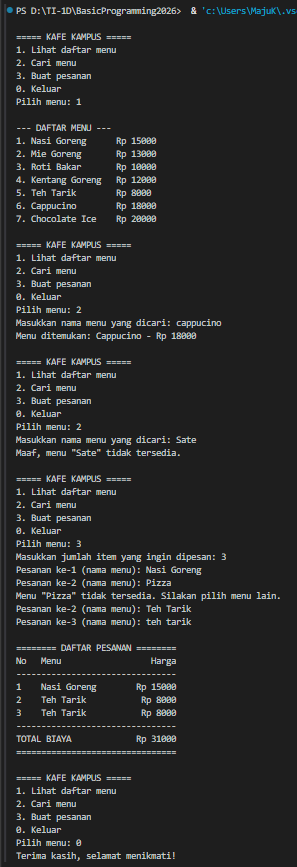

---

## 5: KESIMPULAN

Berdasarkan hasil praktikum Jobsheet 9 - Array 1 Dimensi, dapat disimpulkan bahwa:

1. **Array 1 dimensi** menyimpan sekumpulan data bertipe sama dalam satu variabel dan diakses melalui indeks yang dimulai dari 0. Mengakses indeks di luar rentang (misalnya `i <= bil.length`) menyebabkan `ArrayIndexOutOfBoundsException` saat program dijalankan.

2. **Perulangan `for`, `foreach`, dan `Arrays.toString()`** dapat dipakai untuk menampilkan isi array. `for` dipilih ketika indeks atau perubahan isi array diperlukan (misalnya mengisi array dari input), sedangkan `foreach` dan `Arrays.toString()` cocok untuk membaca atau menampilkan isi saja.

3. **Operasi aritmatika pada array** seperti total, rata-rata, nilai tertinggi, dan nilai terendah dilakukan dengan menelusuri seluruh elemen sambil mengakumulasi hasil ke variabel penampung. Casting `(double)` diperlukan agar rata-rata tidak kehilangan bagian desimalnya.

4. **Linear search** memeriksa elemen satu per satu hingga key ditemukan dan dapat dihentikan dengan `break`, sedangkan **bubble sort** mengurutkan array dengan menukar elemen bersebelahan secara berulang menggunakan dua perulangan bersarang. Mengubah arah urutan cukup dengan membalik tanda perbandingan.

5. **Studi kasus SIAKAD dan kafe kampus** menunjukkan bahwa array cocok untuk menyimpan data sejenis yang jumlahnya diketahui, seperti nilai mahasiswa, daftar menu, dan daftar harga, lalu mengolahnya dengan kombinasi perulangan, agregasi, dan pencarian.
