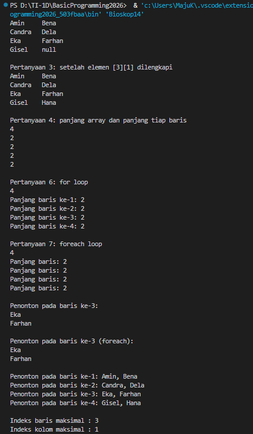

# JOBSHEET 11 - ARRAY 2 DIMENSI

**Identitas Mahasiswa:**

- **Nama:** Fabianugerah Bainasshiddiq
- **NIM:** 264107020026
- **Kelas / No. Presensi:** 1D / 14

---

## 1: TUJUAN PRAKTIKUM

Berikut adalah tujuan pelaksanaan praktikum pada bab ini:

1. Mahasiswa mampu mendeklarasikan, menginstansiasi, dan menginisialisasi array 2 dimensi dalam bahasa Java.
2. Mahasiswa mampu mengakses dan mengisi elemen array 2 dimensi menggunakan indeks baris dan kolom.
3. Mahasiswa mampu memproses array 2 dimensi dengan nested loop, baik `for` maupun `foreach`.
4. Mahasiswa mampu membuat array 2 dimensi dengan panjang baris yang berbeda (*jagged array*).
5. Mahasiswa mampu menghitung nilai rata-rata per baris dan per kolom pada studi kasus nyata.

---

## 2: HASIL PERCOBAAN & ANALISIS

### 2.1 Percobaan 1: Deklarasi, Inisialisasi, dan Menampilkan Array 2 Dimensi

Pada percobaan ini dibuat array `penonton` bertipe `String` dengan 4 baris dan 2 kolom untuk menyimpan nama penonton bioskop mini. Array diisi per elemen dengan indeks baris dan kolom, lalu ditampilkan. Elemen `penonton[3][1]` sengaja belum diisi pada program utama agar sesuai contoh output (`Gisel null`), kemudian dilengkapi pada bagian Pertanyaan 3. Kode juga memuat jawaban berbentuk program untuk Pertanyaan 4 sampai 13.

#### 2.1.1 Kode Program Java

```java
public class Bioskop14 {
    public static void main(String[] args) {
        String[][] penonton = new String[4][2];

        penonton[0][0] = "Amin";
        penonton[0][1] = "Bena";
        penonton[1][0] = "Candra";
        penonton[1][1] = "Dela";
        penonton[2][0] = "Eka";
        penonton[2][1] = "Farhan";
        penonton[3][0] = "Gisel";

        System.out.printf("%s \t %s\n", penonton[0][0], penonton[0][1]);
        System.out.printf("%s \t %s\n", penonton[1][0], penonton[1][1]);
        System.out.printf("%s \t %s\n", penonton[2][0], penonton[2][1]);
        System.out.printf("%s \t %s\n", penonton[3][0], penonton[3][1]);

        // Pertanyaan 3: Lengkapi elemen yang belum terisi
        System.out.println();
        System.out.println("Pertanyaan 3: setelah elemen [3][1] dilengkapi");
        penonton[3][1] = "Hana";
        for (int i = 0; i < penonton.length; i++) {
            System.out.printf("%s \t %s\n", penonton[i][0], penonton[i][1]);
        }

        // Pertanyaan 4: Panjang array dan panjang tiap baris
        System.out.println();
        System.out.println("Pertanyaan 4: panjang array dan panjang tiap baris");
        System.out.println(penonton.length);
        System.out.println(penonton[0].length);
        System.out.println(penonton[1].length);
        System.out.println(penonton[2].length);
        System.out.println(penonton[3].length);

        // Pertanyaan 6: Panjang setiap baris dengan for loop
        System.out.println();
        System.out.println("Pertanyaan 6: for loop");
        System.out.println(penonton.length);
        for (int i = 0; i < penonton.length; i++) {
            System.out.println("Panjang baris ke-" + (i + 1) + ": " + penonton[i].length);
        }

        // Pertanyaan 7: Panjang setiap baris dengan foreach loop
        System.out.println();
        System.out.println("Pertanyaan 7: foreach loop");
        System.out.println(penonton.length);
        for (String[] barisPenonton : penonton) {
            System.out.println("Panjang baris: " + barisPenonton.length);
        }

        // Pertanyaan 8: Penonton baris ke-3 dengan for loop
        System.out.println();
        System.out.println("Penonton pada baris ke-3: ");
        for (int i = 0; i < penonton[2].length; i++) {
            System.out.println(penonton[2][i]);
        }

        // Pertanyaan 9: Penonton baris ke-3 dengan foreach loop
        System.out.println();
        System.out.println("Penonton pada baris ke-3 (foreach): ");
        for (String i : penonton[2]) {
            System.out.println(i);
        }

        // Pertanyaan 10: Penonton setiap baris dengan String.join()
        System.out.println();
        for (int i = 0; i < penonton.length; i++) {
            System.out.println("Penonton pada baris ke-" + (i + 1) + ": " + String.join(", ", penonton[i]));
        }

        // Pertanyaan 12 dan 13: Indeks maksimal
        System.out.println();
        System.out.println("Indeks baris maksimal : " + (penonton.length - 1));
        System.out.println("Indeks kolom maksimal : " + (penonton[0].length - 1));
    }
}
```

#### 2.1.2 Hasil Running / Screenshot Output

Berikut adalah tampilan *output* setelah program dijalankan:



#### 2.1.3 Jawaban Pertanyaan / Pertanyaan Refleksi

- **Pertanyaan 1:** Apakah pengisian elemen array harus dilakukan secara berurutan mulai dari indeks ke-0? Jelaskan!
  - **Jawab:** Tidak harus. Elemen array dapat diisi dalam urutan apa pun selama indeksnya berada dalam rentang valid (0 sampai `length - 1`), misalnya `penonton[3][0]` boleh diisi lebih dulu daripada `penonton[0][0]`. Elemen yang belum diisi tetap berisi nilai default.

- **Pertanyaan 2:** Mengapa terdapat `null` pada daftar nama penonton? Jelaskan dari sisi nilai default array.
  - **Jawab:** Karena elemen `penonton[3][1]` belum diisi. Array bertipe `String` menyimpan referensi objek, dan nilai default elemen array bertipe objek/referensi adalah `null`.

- **Pertanyaan 3:** Lengkapi pengisian pada langkah 3 jika ada elemen yang belum terisi, lalu jalankan kembali program.
  - **Jawab:** Elemen yang belum terisi adalah `penonton[3][1]`, sehingga ditambahkan `penonton[3][1] = "Hana";`. Setelah dilengkapi, baris terakhir tampil `Gisel   Hana` (lihat bagian "Pertanyaan 3" pada kode **2.1.1**).

- **Pertanyaan 4:** Tambahkan kode berikut setelah langkah 4. Jelaskan fungsi dari `penonton.length` dan `penonton[0].length`!

    ```java
    System.out.println(penonton.length);
    System.out.println(penonton[0].length);
    System.out.println(penonton[1].length);
    System.out.println(penonton[2].length);
    System.out.println(penonton[3].length);
    ```

  - **Jawab:** `penonton.length` adalah banyaknya baris pada array 2 dimensi (4), karena array 2 dimensi adalah array yang setiap elemennya berupa array baris. `penonton[0].length` adalah banyaknya kolom pada baris ke-0 (2). Keluarannya adalah `4`, `2`, `2`, `2`, `2`.

- **Pertanyaan 5:** Apakah `penonton[0].length`, `penonton[1].length`, `penonton[2].length`, dan `penonton[3].length` memiliki nilai yang sama? Mengapa?
  - **Jawab:** Ya, semuanya bernilai 2. Array dibuat dengan `new String[4][2]`, sehingga setiap baris dibuat dengan panjang yang sama (2 kolom), membentuk array persegi.

- **Pertanyaan 6:** Modifikasi kode pada pertanyaan 4 untuk menampilkan panjang setiap baris menggunakan `for` loop.

    ```java
    System.out.println(penonton.length);
    for (int i = 0; i < penonton.length; i++) {
        System.out.println("Panjang baris ke-" + (i + 1) + ": " penonton[i].length);
    }
    ```

  - **Jawab:** Keluarannya `4`, lalu `Panjang baris ke-1: 2` sampai `Panjang baris ke-4: 2`. Perulangan memakai `i < penonton.length` sebagai batas dan `penonton[i].length` untuk panjang baris ke-`i`.

- **Pertanyaan 7:** Modifikasi kode pada pertanyaan 5 untuk menampilkan panjang setiap baris menggunakan `foreach` loop.

    ```java
    System.out.println(penonton.length);
    for (String[] barisPenonton : penonton) {
        System.out.println("Panjang baris: " + barisPenonton.length);
    }
    ```

  - **Jawab:** Keluarannya `4`, lalu `Panjang baris: 2` sebanyak empat kali. Variabel `barisPenonton` bertipe `String[]` karena setiap elemen dari `penonton` adalah sebuah array baris. Foreach tidak punya indeks, sehingga nomor baris tidak ditampilkan.

- **Pertanyaan 8:** Tambahkan kode untuk menampilkan nama penonton pada baris ke-3 (indeks 2) menggunakan `for` loop.

    ```java
    System.out.println("Penonton pada baris ke-3: ");
    for (int i = 0; i < penonton[2].length; i++) {
        System.out.println(penonton[2][i]);
    }
    ```

  - **Jawab:** Keluarannya `Penonton pada baris ke-3:` diikuti `Eka` dan `Farhan`. Perulangan berjalan sampai `penonton[2].length`, yaitu jumlah kolom pada baris indeks 2.

- **Pertanyaan 9:** Modifikasi kode pada pertanyaan 8 menjadi perulangan dengan `foreach` loop.

    ```java
    System.out.println("Penonton pada baris ke-3 (foreach): ");
    for (String i : penonton[2]) {
        System.out.println(i);
    }
    ```

  - **Jawab:** `for (String i : penonton[2])` menghasilkan keluaran yang sama, yaitu `Eka` dan `Farhan`, karena `penonton[2]` adalah array 1 dimensi yang berisi nama penonton pada baris ke-3.

- **Pertanyaan 10:** Modifikasi kode pada pertanyaan 9 untuk menampilkan nama penonton setiap baris. Gunakan `String.join()`.

    ```java
    for (int i = 0; i < penonton.length; i++) {
        System.out.println("Penonton pada baris ke-" + (i + 1) + ": " String.join(", ", penonton[i]));
    }
    ```

  - **Jawab:** Keluarannya:

    ```
    Penonton pada baris ke-1: Amin, Bena
    Penonton pada baris ke-2: Candra, Dela
    Penonton pada baris ke-3: Eka, Farhan
    Penonton pada baris ke-4: Gisel, Hana
    ```

- **Pertanyaan 11:** Menurut Anda, apa kekurangan dan kelebihan `foreach` loop dibandingkan `for` loop?
  - **Jawab:**
    - **Kelebihan:** lebih ringkas dan mudah dibaca, serta tidak ada risiko salah menulis batas indeks sehingga terhindar dari `ArrayIndexOutOfBoundsException`.
    - **Kekurangan:** tidak mengetahui indeks elemen, tidak dapat mengubah isi array (variabel foreach hanya salinan nilai), dan tidak fleksibel untuk membandingkan elemen bersebelahan atau menelusuri dua array sekaligus.

- **Pertanyaan 12:** Berapa indeks baris maksimal untuk array `penonton`? Dari mana nilai itu diperoleh?
  - **Jawab:** Indeks baris maksimal adalah 3, diperoleh dari `penonton.length - 1` (4 - 1), karena indeks dimulai dari 0.

- **Pertanyaan 13:** Berapa indeks kolom maksimal untuk array `penonton`? Apakah nilainya sama untuk setiap baris?
  - **Jawab:** Indeks kolom maksimal adalah 1, diperoleh dari `penonton[i].length - 1` (2 - 1). Pada array ini nilainya sama untuk setiap baris karena semua baris memiliki 2 kolom, tetapi pada jagged array nilainya dapat berbeda untuk tiap baris.

- **Pertanyaan 14:** Apa fungsi dari `String.join()`? Jelaskan parameter yang diterimanya.
  - **Jawab:** `String.join()` menggabungkan beberapa string menjadi satu string dengan pemisah tertentu. Parameter pertama adalah pemisah (*delimiter*), misalnya `", "`, dan parameter kedua adalah kumpulan string yang digabung, misalnya array `String[]` seperti `penonton[i]`. Elemen `null` akan ikut tergabung sebagai teks `null`.

- **Pertanyaan Diskusi:** Pada Langkah 2, semua baris dibuat dengan `new String[4][2]`. Jika Anda menulis `penonton[1] = null;` lalu memanggil `penonton[1].length`, apa yang terjadi? Bandingkan dengan `penonton[1][0] = null;`. Jelaskan perbedaan antara **baris yang null** dan **elemen yang null**.
Apakah `penonton.length` dapat berubah setelah array dibuat? Bagaimana jika Anda ingin menambah baris? Diskusikan batasan array di Java.
  - **Jawab:** `penonton[1] = null;` membuat baris ke-1 tidak lagi menunjuk ke array apa pun, sehingga `penonton[1].length` menyebabkan `NullPointerException`. Sedangkan `penonton[1][0] = null;` hanya mengosongkan satu elemen, baris tetap ada dan `penonton[1].length` tetap 2. Jadi **baris yang null** berarti arraynya tidak ada, sedangkan **elemen yang null** berarti arraynya ada tetapi isi elemen tersebut kosong. `penonton.length` tidak dapat berubah setelah array dibuat karena ukuran array bersifat tetap. Untuk menambah baris, harus dibuat array baru yang lebih besar lalu isi lama disalin (misalnya dengan `Arrays.copyOf`), atau memakai struktur data dinamis seperti `ArrayList`.

---

### 2.2 Percobaan 2: Scanner dan Perulangan untuk Input dan Output Array 2 Dimensi

Percobaan ini melanjutkan Percobaan 1, yaitu data penonton dimasukkan lewat keyboard dengan `Scanner` dan perulangan `while (true)`. Pengguna memasukkan nama, nomor baris, dan nomor kolom, lalu memilih apakah masih ada penonton lain. Modifikasi Pertanyaan 2 sampai 5 (menu, validasi baris dan kolom, peringatan kursi terisi, dan tampilan `***` untuk kursi kosong) dibuat pada file terpisah.

#### 2.2.1 Kode Program Java

**BioskopWithScanner14.java:**

```java
import java.util.Arrays;
import java.util.Scanner;

public class BioskopWithScanner14 {
    public static void main(String[] args) {
        Scanner sc = new Scanner(System.in);
        int baris, kolom;
        String nama, pilihan;
        String[][] penonton = new String[4][2];

        while (true) {
            System.out.print("Masukkan nama: ");
            nama = sc.nextLine();
            System.out.print("Masukkan baris: ");
            baris = sc.nextInt();
            System.out.print("Masukkan kolom: ");
            kolom = sc.nextInt();
            sc.nextLine();

            penonton[baris - 1][kolom - 1] = nama;

            System.out.print("Input penonton lainnya? (y/n): ");
            pilihan = sc.nextLine();

            if (pilihan.equalsIgnoreCase("n")) {
                break;
            }
        }

        System.out.println();
        System.out.println(Arrays.deepToString(penonton));

        sc.close();
    }
}
```

**BioskopMenu14.java:** (modifikasi Pertanyaan 2 sampai 5)

```java
import java.util.Scanner;

// Modifikasi Pertanyaan 2 sampai 5 (Percobaan 2): menu, validasi baris/kolom,
public class BioskopMenu14 {
    public static void main(String[] args) {
        Scanner sc = new Scanner(System.in);
        String[][] penonton = new String[4][2];
        int pilihan = 0;

        while (pilihan != 3) {
            System.out.println();
            System.out.println("===== MENU BIOSKOP =====");
            System.out.println("1. Input data penonton");
            System.out.println("2. Tampilkan daftar penonton");
            System.out.println("3. Exit");
            System.out.print("Pilih menu: ");

            if (!sc.hasNextInt()) {
                sc.nextLine();
                System.out.println("Input harus berupa angka.");
                continue;
            }
            pilihan = sc.nextInt();
            sc.nextLine();

            if (pilihan == 1) {
                System.out.print("Masukkan nama: ");
                String nama = sc.nextLine();

                boolean tersimpan = false;
                while (!tersimpan) {
                    System.out.print("Masukkan baris: ");
                    if (!sc.hasNextInt()) {
                        sc.nextLine();
                        System.out.println("Baris harus berupa angka.");
                        continue;
                    }
                    int baris = sc.nextInt();
                    sc.nextLine();

                    System.out.print("Masukkan kolom: ");
                    if (!sc.hasNextInt()) {
                        sc.nextLine();
                        System.out.println("Kolom harus berupa angka.");
                        continue;
                    }
                    int kolom = sc.nextInt();
                    sc.nextLine();

                    // Pertanyaan 3: cek rentang baris dan kolom
                    if (baris < 1 || baris > penonton.length) {
                        System.out.println("Baris tidak tersedia. Pilih baris 1 sampai " + penonton.length + ".");
                    } else if (kolom < 1 || kolom > penonton[baris - 1].length) {
                        System.out.println("Kolom tidak tersedia. Pilih kolom 1 sampai " + penonton[baris - 1].length + ".");
                    } else if (penonton[baris - 1][kolom - 1] != null) {
                        // Pertanyaan 4: kursi sudah terisi
                        System.out.println("Kursi (" + baris + "," + kolom + ") sudah terisi oleh "
                                + penonton[baris - 1][kolom - 1] + ". Pilih kursi lain.");
                    } else {
                        penonton[baris - 1][kolom - 1] = nama;
                        System.out.println("Data penonton berhasil disimpan.");
                        tersimpan = true;
                    }
                }

            } else if (pilihan == 2) {
                // Pertanyaan 5: kursi kosong ditampilkan sebagai ***
                System.out.println("--- Daftar Penonton ---");
                for (int i = 0; i < penonton.length; i++) {
                    System.out.print("Baris " + (i + 1) + ": ");
                    for (int j = 0; j < penonton[i].length; j++) {
                        String isi = (penonton[i][j] == null) ? "***" : penonton[i][j];
                        System.out.printf("%-10s", isi);
                    }
                    System.out.println();
                }

            } else if (pilihan != 3) {
                System.out.println("Menu tidak tersedia.");
            }
        }

        System.out.println("Terima kasih.");
        sc.close();
    }
}
```

#### 2.2.2 Tabel Pengujian Parameter Output

**BioskopWithScanner14:**

| Uji | Nama | Baris | Kolom | Lanjut? | Status Eksekusi |
| :-: | :-: | :-: | :-: | :-: | :-: |
| 1 | Agus | 1 | 2 | y | Tersimpan pada kursi (1,2) |
| 2 | Indah | 2 | 1 | y | Tersimpan pada kursi (2,1) |
| 3 | Sonya | 3 | 1 | y | Tersimpan pada kursi (3,1) |
| 4 | Fuady | 3 | 2 | n | Tersimpan pada kursi (3,2), input berhenti |

**BioskopMenu14:**

| Uji | Menu | Input | Status Eksekusi |
| :-: | :-: | :-: | :-: |
| 1 | 2 (tampilkan) | Sebelum ada data | Semua kursi tampil `***` |
| 2 | 1 (input) | Baris `7` | Baris tidak tersedia. Pilih baris 1 sampai 4. |
| 3 | 1 (input) | Baris `1`, kolom `0` | Kolom tidak tersedia. Pilih kolom 1 sampai 2. |
| 4 | 1 (input) | Nama `Agus`, baris `1`, kolom `1` | Data penonton berhasil disimpan. |
| 5 | 1 (input) | Nama `Indah`, baris `1`, kolom `1` | Kursi (1,1) sudah terisi oleh Agus. Pilih kursi lain. |
| 6 | 1 (input) | Baris `abc` | Baris harus berupa angka. |
| 7 | 1 (input) | Baris `1`, kolom `2` (nama Indah) | Data penonton berhasil disimpan. |
| 8 | 2 (tampilkan) | Setelah Uji 7 | Baris 1: `Agus`, `Indah`. Baris 2 sampai 4: `***`, `***` |
| 9 | Menu | `x` | Input harus berupa angka. |
| 10 | Menu | `9` | Menu tidak tersedia. |
| 11 | 3 (exit) | - | Terima kasih., program berhenti |

#### 2.2.3 Jawaban Pertanyaan / Pertanyaan Refleksi

- **Pertanyaan 1:** Apakah pengisian elemen array dari Scanner harus dilakukan secara berurutan mulai dari indeks ke-0? Jelaskan!
  - **Jawab:** Tidak harus. Posisi elemen ditentukan oleh nomor baris dan kolom yang dimasukkan pengguna, sehingga pengguna dapat mengisi kursi mana pun lebih dulu. Pada contoh sesi, kursi (1,2) terisi sementara kursi (1,1) masih kosong.

- **Pertanyaan 2:** Modifikasi program agar menampilkan menu (1 Input data penonton, 2 Tampilkan daftar penonton, 3 Exit).
  - **Jawab:** Perulangan `while (pilihan != 3)` menampilkan menu pada setiap putaran, lalu `if / else if` menjalankan input data (pilihan 1) atau menampilkan daftar penonton (pilihan 2). Program berhenti saat pilihan 3 (lihat `BioskopMenu14.java`).

- **Pertanyaan 3:** Modifikasi program untuk menangani nomor baris atau kolom yang tidak tersedia (misalnya baris 7 atau kolom 0).
  - **Jawab:** Sebelum mengisi array, program memeriksa `baris < 1 || baris > penonton.length` untuk baris, lalu `kolom < 1 || kolom > penonton[baris - 1].length` untuk kolom. Pemeriksaan baris dilakukan lebih dulu karena `penonton[baris - 1]` baru aman diakses jika baris valid. Jika tidak valid, program menampilkan pesan dan meminta input ulang.

- **Pertanyaan 4:** Pada menu 1, tampilkan peringatan jika kursi yang dipilih sudah terisi penonton lain, lalu minta baris dan kolom kembali.
  - **Jawab:** Setelah baris dan kolom dinyatakan valid, program memeriksa `penonton[baris - 1][kolom - 1] != null`. Jika benar, kursi sudah terisi sehingga ditampilkan peringatan beserta nama penghuninya, dan perulangan input baris dan kolom diulang sampai data berhasil disimpan.

- **Pertanyaan 5:** Pada menu 2, jika sebuah kursi kosong (`null`), tampilkan `***` sebagai pengganti `null`.
  - **Jawab:** Setiap elemen dicek dengan `(penonton[i][j] == null) ? "***" : penonton[i][j]`, lalu hasilnya dicetak. Dengan demikian kursi kosong tampil sebagai `***`.

- **Pertanyaan Diskusi:** Jika pengguna mengetik huruf pada prompt baris, `nextInt()` akan melempar `InputMismatchException`. Bagaimana program seharusnya menangani kesalahan input ini.
Jika jumlah baris dan kolom kursi ditentukan pengguna saat program berjalan, bagian mana yang harus diubah? Mengapa array 2 dimensi tidak bisa diubah ukurannya setelah dibuat?
  - **Jawab:**
    - **Penanganan input huruf:** sebelum memanggil `nextInt()`, program mengecek `sc.hasNextInt()`. Jika bukan angka, input dibuang dengan `sc.nextLine()`, pesan kesalahan ditampilkan, dan pengguna diminta mengulang (lihat `BioskopMenu14.java`). Cara lain adalah `try-catch` untuk menangkap `InputMismatchException`.
    - **Ukuran dari input pengguna:** deklarasi `new String[4][2]` diganti dengan membaca `jumlahBaris` dan `jumlahKolom` terlebih dahulu, lalu `new String[jumlahBaris][jumlahKolom]`. Semua pemeriksaan rentang harus memakai `length`, bukan angka tetap.
    - **Ukuran tidak bisa diubah:** saat array dibuat, Java mengalokasikan blok memori dengan ukuran tetap sehingga panjangnya tidak dapat diperbesar atau diperkecil. Untuk ukuran baru harus dibuat array baru lalu isi lama disalin.

---

### 2.3 Percobaan 3: Array 2 Dimensi dengan Panjang Baris Berbeda

Percobaan ini membuat jagged array `myNumbers` dengan 3 baris yang jumlah kolomnya berbeda: baris pertama 5 kolom, baris kedua 3 kolom, dan baris ketiga 1 kolom. Array dibuat dengan `new int[3][]`, kemudian setiap baris diinstansiasi sendiri-sendiri. Kode juga memuat jawaban berbentuk program untuk Pertanyaan 2, 3, 5, 7, dan Pertanyaan Diskusi.

#### 2.3.1 Kode Program Java

```java
import java.util.Arrays;

public class Numbers14 {
    public static void main(String[] args) {
        int[][] myNumbers = new int[3][];
        myNumbers[0] = new int[5];
        myNumbers[1] = new int[3];
        myNumbers[2] = new int[1];

        for (int i = 0; i < myNumbers.length; i++) {
            System.out.println(Arrays.toString(myNumbers[i]));
        }

        // Pertanyaan 2: Arrays.toString() pada array 2 dimensi
        System.out.println();
        System.out.println("Pertanyaan 2: Arrays.toString(myNumbers)");
        System.out.println(Arrays.toString(myNumbers));

        // Pertanyaan 3: Arrays.deepToString()
        System.out.println();
        System.out.println("Pertanyaan 3: Arrays.deepToString(myNumbers)");
        System.out.println(Arrays.deepToString(myNumbers));

        // Pertanyaan 5: panjang setiap baris
        System.out.println();
        System.out.println("Pertanyaan 5: panjang setiap baris");
        for (int i = 0; i < myNumbers.length; i++) {
            System.out.println("Panjang baris ke-" + (i + 1) + ": " + myNumbers[i].length);
        }

        // Pertanyaan 7: mengganti baris pertama dengan array baru
        System.out.println();
        System.out.println("Pertanyaan 7: myNumbers[0] = new int[7]");
        myNumbers[0] = new int[7];
        System.out.println("myNumbers.length    : " + myNumbers.length);
        System.out.println("myNumbers[0].length : " + myNumbers[0].length);

        // Pertanyaan Diskusi: menyalin array 2 dimensi
        System.out.println();
        System.out.println("Diskusi: menyalin array 2 dimensi");

        // 1) Menyalin referensi: kedua variabel menunjuk array yang sama
        int[][] salinan = myNumbers;
        salinan[0][0] = 99;
        System.out.println("Setelah salinan[0][0] = 99, myNumbers[0][0] = " + myNumbers[0][0]);

        // 2) clone() hanya menyalin lapisan luar (shallow copy)
        int[][] klon = myNumbers.clone();
        klon[2][0] = 77;
        System.out.println("Setelah klon[2][0] = 77, myNumbers[2][0] = " + myNumbers[2][0]);

        // 3) Salinan dalam (deep copy)
        int[][] salinanDalam = new int[myNumbers.length][];
        for (int i = 0; i < myNumbers.length; i++) {
            salinanDalam[i] = new int[myNumbers[i].length];
            for (int j = 0; j < myNumbers[i].length; j++) {
                salinanDalam[i][j] = myNumbers[i][j];
            }
        }
        salinanDalam[1][0] = 55;
        System.out.println("Setelah salinanDalam[1][0] = 55, myNumbers[1][0] = " + myNumbers[1][0]);
    }
}
```

#### 2.3.2 Tabel Pengujian Parameter Output

| Uji | Perintah | Status Eksekusi |
| :-: | :-: | :-- |
| 1 | `Arrays.toString(myNumbers[i])` untuk tiap baris | `[0, 0, 0, 0, 0]`, `[0, 0, 0]`, `[0]` |
| 2 | `Arrays.toString(myNumbers)` | `[[I@159f197, [I@78aab498, [I@5dd6264]` (nilai setelah `@` berbeda di tiap komputer) |
| 3 | `Arrays.deepToString(myNumbers)` | `[[0, 0, 0, 0, 0], [0, 0, 0], [0]]` |
| 4 | Panjang setiap baris | 5, 3, 1 |
| 5 | `myNumbers[0] = new int[7]` | `myNumbers.length` = 3, `myNumbers[0].length` = 7 |
| 6 | `salinan = myNumbers; salinan[0][0] = 99` | `myNumbers[0][0]` = 99 |
| 7 | `klon = myNumbers.clone(); klon[2][0] = 77` | `myNumbers[2][0]` = 77 |
| 8 | Salinan dalam, `salinanDalam[1][0] = 55` | `myNumbers[1][0]` tetap 0 |

#### 2.3.3 Jawaban Pertanyaan / Pertanyaan Refleksi

- **Pertanyaan 1:** Apa fungsi dari `Arrays.toString()`?
  - **Jawab:** Mengubah isi array 1 dimensi menjadi string berformat `[elemen1, elemen2, ...]` sehingga dapat dicetak dalam satu baris tanpa perulangan manual.

- **Pertanyaan 2:** Ganti pemanggilan pada Kode 16 menjadi `Arrays.toString(myNumbers)`. Apa yang tampil? Jelaskan.
  - **Jawab:** Yang tampil adalah kode seperti `[[I@159f197, [I@78aab498, [I@5dd6264]`, bukan angka-angkanya. Elemen `myNumbers` adalah array (objek), dan `Arrays.toString()` hanya mengubah tiap elemen menjadi teks satu tingkat. Teks bawaan sebuah array berisi kode tipe (`[I` berarti array `int`) dan alamat objeknya.

- **Pertanyaan 3:** Jalankan juga `Arrays.deepToString(myNumbers)`. Bandingkan dengan Kode 16. Mengapa `deepToString()` diperlukan untuk array 2 dimensi?
  - **Jawab:** `deepToString()` menghasilkan `[[0, 0, 0, 0, 0], [0, 0, 0], [0]]`, yaitu seluruh isi dalam satu baris, sedangkan Kode 16 mencetak satu baris array per perintah di dalam perulangan. `deepToString()` diperlukan karena menelusuri array bertingkat secara rekursif, sehingga isi array di dalam array ikut tampil.

- **Pertanyaan 4:** Apa nilai default untuk elemen array dengan tipe data `int`?
  - **Jawab:** `0`.

- **Pertanyaan 5:** Tambahkan kode untuk menampilkan panjang setiap baris.

    ```java
    for (int i = 0; i < myNumbers.length; i++) {
        System.out.println("Panjang baris ke-" + (i + 1) + ": " myNumbers[i].length);
    }
    ```

  - **Jawab:** Keluarannya `Panjang baris ke-1: 5`, `Panjang baris ke-2: 3`, dan `Panjang baris ke-3: 1`. Hasil ini membuktikan setiap baris memiliki panjang berbeda.

- **Pertanyaan 6:** Apakah panjang array dapat dimodifikasi setelah diinstansiasi? Jelaskan.
  - **Jawab:** Tidak. Panjang array bersifat tetap sejak instansiasi. Yang dapat dilakukan hanyalah membuat array baru dan mengarahkan variabel (atau elemen baris) ke array baru tersebut.

- **Pertanyaan 7:** Jalankan `myNumbers[0] = new int[7];`, lalu cetak `myNumbers.length` dan `myNumbers[0].length`. Bagian mana yang berubah? Mengapa?
  - **Jawab:** `myNumbers.length` tetap 3, sedangkan `myNumbers[0].length` berubah dari 5 menjadi 7. Perintah tersebut tidak memperpanjang array lama, tetapi mengganti baris ke-0 dengan array baru berukuran 7 (seluruh isinya 0). Array luar tetap memiliki 3 elemen.

- **Pertanyaan Diskusi:** Jalankan kode berikut: `int[][] salinan = myNumbers; salinan[0][0] = 99; System.out.println(myNumbers[0][0]);`. Mengapa nilai myNumbers ikut berubah? Apa perbedaannya dengan menyalin nilai satu per satu menggunakan perulangan?
Jika Anda ingin menyalin array 2 dimensi secara benar, bagaimana kode penyalinannya? Apakah `clone()` sudah cukup? Coba uji dengan array yang berisi array.
  - **Jawab:** `salinan = myNumbers` hanya menyalin referensi, bukan isi array, sehingga kedua variabel menunjuk ke objek array yang sama dan `myNumbers[0][0]` ikut menjadi 99. Penyalinan satu per satu dengan perulangan membuat array baru yang terpisah sehingga perubahan pada salinan tidak memengaruhi aslinya. Penyalinan yang benar dilakukan per baris (*deep copy*): buat array luar baru, lalu untuk setiap baris buat array baru dan salin nilainya. `clone()` belum cukup karena hanya menyalin lapisan luar (*shallow copy*): baris-barisnya tetap dipakai bersama, terbukti dari `klon[2][0] = 77` yang mengubah `myNumbers[2][0]` menjadi 77. Sedangkan pada salinan dalam, `salinanDalam[1][0] = 55` tidak mengubah `myNumbers[1][0]`.

---

### 2.4 Percobaan 4: Studi Kasus SIAKAD

Dosen memasukkan nilai tiga mata kuliah (Dasar Pemrograman, Matematika, dan CTPS) untuk 4 mahasiswa ke dalam array `nilai[4][3]` (baris = mahasiswa, kolom = mata kuliah). Program menghitung rata-rata setiap mahasiswa (rata-rata per baris) dan rata-rata setiap mata kuliah (rata-rata per kolom). Modifikasi Pertanyaan 1 (jumlah mahasiswa dan mata kuliah dari input) dibuat pada file terpisah.

#### 2.4.1 Kode Program Java

**SIAKAD14.java:**

```java
import java.util.Scanner;

public class SIAKAD14 {
    public static void main(String[] args) {
        Scanner sc = new Scanner(System.in);

        int[][] nilai = new int[4][3];

        for (int i = 0; i < nilai.length; i++) {
            System.out.println("Input nilai mahasiswa ke-" + (i + 1));
            double totalPerSiswa = 0;

            for (int j = 0; j < nilai[i].length; j++) {
                System.out.print("Nilai mata kuliah " + (j + 1) + ": ");
                nilai[i][j] = sc.nextInt();
                totalPerSiswa += nilai[i][j];
            }

            System.out.println("Nilai rata-rata: " + totalPerSiswa / nilai[i].length);
        }

        System.out.println("\n========================================");
        System.out.println("Rata-rata nilai setiap mata kuliah:");

        for (int j = 0; j < nilai[0].length; j++) {
            double totalPerMatkul = 0;

            for (int i = 0; i < nilai.length; i++) {
                totalPerMatkul += nilai[i][j];
            }

            System.out.println("Mata kuliah " + (j + 1) + ": " + totalPerMatkul / nilai.length);
        }

        sc.close();
    }
}
```

**SIAKADDinamis14.java:** (modifikasi Pertanyaan 1)

```java
import java.util.Scanner;

// Modifikasi Pertanyaan 1 (Percobaan 4)
public class SIAKADDinamis14 {
    public static void main(String[] args) {
        Scanner sc = new Scanner(System.in);

        System.out.print("Masukkan jumlah mahasiswa: ");
        int jumlahMahasiswa = sc.nextInt();
        System.out.print("Masukkan jumlah mata kuliah: ");
        int jumlahMataKuliah = sc.nextInt();

        int[][] nilai = new int[jumlahMahasiswa][jumlahMataKuliah];

        for (int i = 0; i < nilai.length; i++) {
            System.out.println("Input nilai mahasiswa ke-" + (i + 1));
            double totalPerSiswa = 0;

            for (int j = 0; j < nilai[i].length; j++) {
                System.out.print("Nilai mata kuliah " + (j + 1) + ": ");
                nilai[i][j] = sc.nextInt();
                totalPerSiswa += nilai[i][j];
            }

            System.out.println("Nilai rata-rata: " + totalPerSiswa / nilai[i].length);
        }

        System.out.println("\n========================================");
        System.out.println("Rata-rata nilai setiap mata kuliah:");

        for (int j = 0; j < nilai[0].length; j++) {
            double totalPerMatkul = 0;

            for (int i = 0; i < nilai.length; i++) {
                totalPerMatkul += nilai[i][j];
            }

            System.out.println("Mata kuliah " + (j + 1) + ": " + totalPerMatkul / nilai.length);
        }

        sc.close();
    }
}
```

#### 2.4.2 Tabel Pengujian Parameter Output

**SIAKAD14:** (4 mahasiswa, 3 mata kuliah):

| Mahasiswa | Mata Kuliah 1 | Mata Kuliah 2 | Mata Kuliah 3 | Rata-rata Mahasiswa |
| :-: | :-: | :-: | :-: | :-: |
| 1 | 80 | 70 | 90 | 80.0 |
| 2 | 60 | 75 | 90 | 75.0 |
| 3 | 85 | 90 | 95 | 90.0 |
| 4 | 70 | 80 | 90 | 80.0 |
| **Rata-rata Mata Kuliah** | **73.75** | **78.75** | **91.25** | - |

**SIAKADDinamis14:** (3 mahasiswa, 2 mata kuliah):

| Mahasiswa | Mata Kuliah 1 | Mata Kuliah 2 | Rata-rata Mahasiswa |
| :-: | :-: | :-: | :-: |
| 1 | 80 | 70 | 75.0 |
| 2 | 60 | 90 | 75.0 |
| 3 | 100 | 50 | 75.0 |
| **Rata-rata Mata Kuliah** | **80.0** | **70.0** | - |

#### 2.4.3 Jawaban Pertanyaan / Pertanyaan Refleksi

- **Pertanyaan 1:** Bagaimana jika jumlah mahasiswa dan jumlah mata kuliah berubah? Modifikasi program SIAKAD agar jumlah mahasiswa dan mata kuliah dapat ditentukan saat program berjalan.
**Petunjuk:** gunakan `Scanner` untuk membaca dua nilai tersebut, lalu buat array dengan `new int[jumlahMahasiswa][jumlahMataKuliah]`. Pastikan semua perulangan memakai length, bukan angka tetap.
  - **Jawab:** Jumlah mahasiswa dan mata kuliah dibaca lebih dulu dengan `Scanner`, lalu array dibuat dengan `new int[jumlahMahasiswa][jumlahMataKuliah]`. Semua perulangan dan pembagi rata-rata memakai `nilai.length` dan `nilai[i].length`, bukan angka tetap, sehingga program tetap benar untuk ukuran berapa pun (lihat `SIAKADDinamis14.java`).

- **Pertanyaan Diskusi:** Pada Kode 20, variabel `totalPerSiswa` dideklarasikan di dalam loop luar. Apa yang terjadi jika deklarasinya dipindah ke luar loop? Jelaskan dengan contoh nilai.
Jika ada nilai yang belum diisi (bernilai 0 secara default), bagaimana pengaruhnya terhadap rata-rata? Diskusikan apakah program perlu membedakan "belum diisi" dari "nilainya 0".
  - **Jawab:**
    - **Deklarasi di luar loop:** `totalPerSiswa` tidak di-reset ke 0 untuk setiap mahasiswa, sehingga totalnya menumpuk dari mahasiswa sebelumnya. Contoh: mahasiswa 1 bernilai 80, 70, 90 (total 240, rata-rata 80.0 benar). Jika total tidak di-reset, mahasiswa 2 bernilai 60, 60, 60 menghasilkan total 240 + 180 = 420 sehingga rata-ratanya 140.0, yang salah karena melebihi nilai maksimum.
    - **Nilai 0 default:** nilai yang belum diisi tetap ikut dihitung sebagai 0 pada pembagi sehingga menurunkan rata-rata, padahal sebenarnya belum ada nilainya. Program sebaiknya membedakan "belum diisi" dari "bernilai 0", misalnya memakai `Integer[][]` yang berisi `null` untuk nilai kosong, nilai penanda seperti -1, atau array `boolean` terpisah, lalu hanya menghitung elemen yang sudah terisi.

---

## 3: TUGAS MANDIRI

Berikut adalah daftar tugas yang dikerjakan pada Jobsheet ini:

- [x] **Tugas 1:** Implementasikan flowchart latihan survei pada slide Dasar Pemrograman (Teori) ke dalam program Java. Data survei terdiri dari 10 responden dan 6 pertanyaan dengan jawaban 1 sampai 5.
Program harus:
  - menyimpan hasil survei ke dalam array 2 dimensi;
  - menampilkan nilai rata-rata untuk setiap responden;
  - menampilkan nilai rata-rata untuk setiap pertanyaan;
  - menampilkan nilai rata-rata secara keseluruhan.

### 3.1 Tugas 1: Survei 10 Responden dan 6 Pertanyaan

Hasil survei disimpan pada array `survei[10][6]` (baris = responden, kolom = pertanyaan). Jumlah responden dan pertanyaan disimpan dalam konstanta `JUMLAH_RESPONDEN` dan `JUMLAH_PERTANYAAN` yang dipakai pada semua perulangan. Jawaban di luar rentang 1 sampai 5 ditolak dan diminta ulang dengan `do-while`. Rata-rata responden dihitung per baris, rata-rata pertanyaan dihitung per kolom, dan rata-rata keseluruhan dihitung dari seluruh jawaban.

#### 3.1.1 Kode Program Java

```java
import java.util.Scanner;

public class tugasSurvei14 {
    public static void main(String[] args) {
        Scanner sc = new Scanner(System.in);

        final int JUMLAH_RESPONDEN = 10;
        final int JUMLAH_PERTANYAAN = 6;

        int[][] survei = new int[JUMLAH_RESPONDEN][JUMLAH_PERTANYAAN];

        for (int i = 0; i < JUMLAH_RESPONDEN; i++) {
            System.out.println("Responden ke-" + (i + 1));

            for (int j = 0; j < JUMLAH_PERTANYAAN; j++) {
                int jawaban;
                do {
                    System.out.print("Jawaban pertanyaan " + (j + 1) + " (1-5): ");
                    jawaban = sc.nextInt();
                    if (jawaban < 1 || jawaban > 5) {
                        System.out.println("Jawaban tidak valid. Masukkan angka 1 sampai 5!");
                    }
                } while (jawaban < 1 || jawaban > 5);

                survei[i][j] = jawaban;
            }
        }

        System.out.println("\n========================================");
        System.out.println("Rata-rata nilai setiap responden:");
        double totalSemua = 0;

        for (int i = 0; i < JUMLAH_RESPONDEN; i++) {
            double totalPerResponden = 0;

            for (int j = 0; j < JUMLAH_PERTANYAAN; j++) {
                totalPerResponden += survei[i][j];
            }

            totalSemua += totalPerResponden;
            System.out.printf("Responden %d: %.2f%n", (i + 1), totalPerResponden / JUMLAH_PERTANYAAN);
        }

        System.out.println("\n========================================");
        System.out.println("Rata-rata nilai setiap pertanyaan:");

        for (int j = 0; j < JUMLAH_PERTANYAAN; j++) {
            double totalPerPertanyaan = 0;

            for (int i = 0; i < JUMLAH_RESPONDEN; i++) {
                totalPerPertanyaan += survei[i][j];
            }

            System.out.printf("Pertanyaan %d: %.2f%n", (j + 1), totalPerPertanyaan / JUMLAH_RESPONDEN);
        }

        System.out.println("\n========================================");
        System.out.printf("Rata-rata keseluruhan: %.2f%n", totalSemua / (JUMLAH_RESPONDEN * JUMLAH_PERTANYAAN));

        sc.close();
    }
}
```

#### 3.1.2 Tabel Pengujian Parameter Output

Data uji (jawaban 1 sampai 5) dan hasil program:

| Responden | P1 | P2 | P3 | P4 | P5 | P6 | Rata-rata |
| :-: | :-: | :-: | :-: | :-: | :-: | :-: | :-: |
| 1 | 1 | 3 | 5 | 2 | 4 | 1 | 2.67 |
| 2 | 2 | 5 | 3 | 1 | 4 | 2 | 2.83 |
| 3 | 5 | 4 | 3 | 2 | 1 | 5 | 3.33 |
| 4 | 5 | 5 | 5 | 5 | 5 | 5 | 5.00 |
| 5 | 2 | 3 | 4 | 5 | 1 | 2 | 2.83 |
| 6 | 1 | 3 | 5 | 2 | 4 | 1 | 2.67 |
| 7 | 2 | 5 | 3 | 1 | 4 | 2 | 2.83 |
| 8 | 5 | 4 | 3 | 2 | 1 | 5 | 3.33 |
| 9 | 5 | 5 | 5 | 5 | 5 | 5 | 5.00 |
| 10 | 2 | 3 | 4 | 5 | 1 | 2 | 2.83 |
| **Rata-rata** | **3.00** | **4.00** | **4.00** | **3.00** | **3.00** | **3.00** | **3.33** |

Rata-rata keseluruhan: **3.33**. Program juga diuji dengan jawaban `0` pada pertanyaan pertama responden 1, dan menampilkan "Jawaban tidak valid. Masukkan angka 1 sampai 5!" lalu meminta input ulang.

---

## 4: REFLEKSI

- **Pertanyaan 1:** Sebutkan dua situasi nyata yang cocok dimodelkan dengan array 2 dimensi, dan jelaskan apa yang menjadi baris serta kolomnya.
  - **Jawab:**
    - **Nilai mahasiswa pada SIAKAD:** baris adalah mahasiswa dan kolom adalah mata kuliah (seperti Percobaan 4).
    - **Denah kursi bioskop:** baris adalah barisan kursi dan kolom adalah nomor kursi pada barisan tersebut (seperti Percobaan 1 dan 2).

- **Pertanyaan 2:** Apa perbedaan utama antara array 2 dimensi yang persegi dan jagged array? Berikan satu contoh penggunaan untuk masing-masing.
  - **Jawab:** Pada array persegi, setiap baris memiliki jumlah kolom yang sama dan semuanya dibuat sekaligus (`new int[4][3]`). Pada jagged array, setiap baris dapat memiliki jumlah kolom berbeda dan harus diinstansiasi satu per satu (`new int[3][]`, lalu `myNumbers[0] = new int[5]`, dan seterusnya). Contoh array persegi: tabel nilai 4 mahasiswa x 3 mata kuliah. Contoh jagged array: daftar mata kuliah yang diambil setiap mahasiswa, karena jumlah mata kuliah tiap mahasiswa bisa berbeda.

- **Pertanyaan 3:** Di bagian mana pada jobsheet ini Anda paling sering melakukan kesalahan indeks? Bagaimana cara mencegahnya?
  - **Jawab:** Kesalahan indeks paling mudah terjadi pada Percobaan 2, yaitu saat mengubah nomor baris dan kolom dari pengguna (mulai dari 1) menjadi indeks array (mulai dari 0) sehingga harus ditulis `penonton[baris - 1][kolom - 1]`. Kesalahan lain yang umum adalah batas perulangan `<=` yang seharusnya `<`. Cara mencegahnya: selalu memakai `length` sebagai batas perulangan (bukan angka tetap), memeriksa rentang baris dan kolom sebelum mengakses array, dan menguji dengan nilai batas seperti baris 0, baris 5, dan kolom 3.

---

## 5: KESIMPULAN

Berdasarkan hasil praktikum Jobsheet 11 tentang Array 2 Dimensi, dapat disimpulkan bahwa:

1. **Array 2 dimensi** adalah array yang setiap elemennya berupa array. Elemen diakses dengan dua indeks, `array[baris][kolom]`, dan `array.length` menyatakan jumlah baris sedangkan `array[i].length` menyatakan jumlah kolom pada baris ke-`i`. Elemen yang belum diisi bernilai default (`null` untuk `String`, `0` untuk `int`).

2. **Nested loop** dipakai untuk memproses seluruh elemen: perulangan luar untuk baris dan perulangan dalam untuk kolom. Rata-rata per baris dihitung dengan menjumlahkan kolom pada satu baris, sedangkan rata-rata per kolom dihitung dengan menukar urutan perulangan. Penggunaan `length` sebagai batas membuat program tetap benar saat ukuran data berubah.

3. **Jagged array** memungkinkan setiap baris memiliki panjang berbeda dan dibuat dengan `new int[3][]`, lalu setiap baris diinstansiasi sendiri-sendiri. Ukuran array tidak dapat diubah setelah dibuat, tetapi sebuah baris dapat diganti dengan array baru.

4. **Penyalinan array 2 dimensi** harus dilakukan per baris (*deep copy*). Menyalin referensi atau memakai `clone()` hanya menghasilkan salinan dangkal sehingga perubahan pada salinan ikut mengubah array asli. Untuk menampilkan isi array bertingkat dipakai `Arrays.deepToString()`.

5. **Validasi input** seperti memeriksa rentang baris dan kolom, kursi yang sudah terisi, dan input bukan angka membuat program lebih andal dan terhindar dari `ArrayIndexOutOfBoundsException`, `NullPointerException`, dan `InputMismatchException`.
