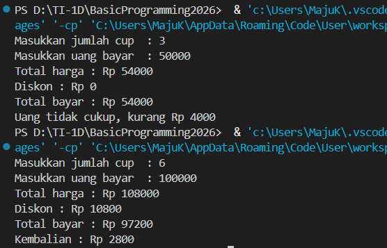
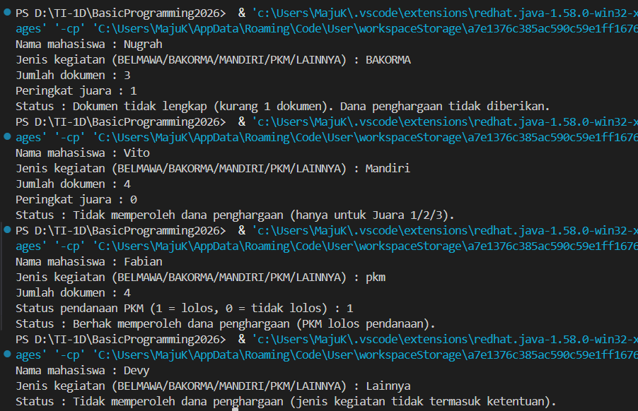

# JOBSHEET 6 - STUDI KASUS PEMILIHAN DENGAN GIT DAN GITHUB

**Identitas Mahasiswa:**

- **Nama:** Fabianugerah Bainasshiddiq
- **NIM:** 264107020026
- **Kelas / No. Presensi:** 1D / 14

---

## 1: TUJUAN PRAKTIKUM

Berikut adalah tujuan pelaksanaan praktikum pada bab ini:

1. Mahasiswa mampu menyelesaikan studi kasus menggunakan struktur pemilihan dasar dan pemilihan bersarang.
2. Mahasiswa mampu menyimpan dan mengumpulkan pekerjaan menggunakan Git dan GitHub melalui Visual Studio Code.
3. Mahasiswa mampu berkolaborasi dengan teman menggunakan GitHub.

---

## 2: HASIL PERCOBAAN & ANALISIS

### 2.1 Percobaan 1: Menyiapkan Repository

Pada percobaan ini dibuat repository `PraktikumDaspro14` di GitHub, lalu di-clone ke komputer melalui Visual Studio Code. Setelah itu dibuat file `README.md` berisi identitas, kemudian disimpan dengan alur **Add → Commit → Push**.

#### 2.1.1 Jawaban Pertanyaan / Pertanyaan Refleksi

- **Alur kerja Git yang digunakan:**
  - **Clone:** menduplikasi repository GitHub ke komputer.
  - **Add:** memilih perubahan yang akan disimpan ke staging area.
  - **Commit:** menyimpan perubahan sebagai version baru di local repository.
  - **Push:** mengirim commit dari local repository ke GitHub.

---

### 2.2 Percobaan 2: Studi Kasus 1 - Pemilihan Dasar

Kedai Kopi Senja menjual Kopi Susu Gula Aren seharga Rp18.000 per cup dan memberikan diskon 10% untuk pembelian minimal Rp100.000. Program menghitung total bayar dan kembalian berdasarkan flowchart yang diberikan.

#### 2.2.1 Kode Program Java

```java
import java.util.Scanner;

public class StudiKasus1_14 {
    public static void main(String[] args) {
        Scanner sc = new Scanner(System.in);

        int hargaPerCup = 18000;
        int jumlahCup, uangBayar;
        int totalHarga, diskon, totalBayar;
        int kembalian, kurang;

        System.out.print("Masukkan jumlah cup  : ");
        jumlahCup = sc.nextInt();
        System.out.print("Masukkan uang bayar  : ");
        uangBayar = sc.nextInt();

        totalHarga = jumlahCup * hargaPerCup;
        diskon = 0;

        if (totalHarga >= 100000) {
            diskon = totalHarga * 10 / 100;
        }

        totalBayar = totalHarga - diskon;

        System.out.println("Total harga : Rp " + totalHarga);
        System.out.println("Diskon : Rp " + diskon);
        System.out.println("Total bayar : Rp " + totalBayar);

        if (uangBayar >= totalBayar) {
            kembalian = uangBayar - totalBayar;
            System.out.println("Kembalian : Rp " + kembalian);
        } else {
            kurang = totalBayar - uangBayar;
            System.out.println("Uang tidak cukup, kurang Rp " + kurang);
        }

        sc.close();
    }
}
```

#### 2.2.2 Hasil Running / Screenshot Output

Berikut adalah contoh tampilan _output_ setelah program dijalankan:



#### 2.2.3 Tabel Pengujian Parameter Output

| Uji | Jumlah Cup | Uang Bayar | Total Harga | Diskon | Total Bayar | Output |
| :-: | :-: | :-: | :-: | :-: | :-: | :-: |
| 1 | 3 | 50000 | Rp54.000 | Rp0 | Rp54.000 | Uang tidak cukup, kurang Rp4000 |
| 2 | 6 | 100000 | Rp108.000 | Rp10.800 | Rp97.200 | Kembalian Rp2800 |

#### 2.2.4 Penjelasan Program

- Diskon hanya diberikan jika `totalHarga >= 100000`. Jika tidak, `diskon` tetap bernilai 0 sesuai nilai awalnya.
- Pemilihan kedua membandingkan `uangBayar` dengan `totalBayar` untuk menentukan apakah program menampilkan kembalian atau kekurangan.

---

### 2.3 Percobaan 3: Studi Kasus 2 - Pemilihan Bersarang

Program membantu Admin Kemahasiswaan mengecek status dana penghargaan prestasi mahasiswa menggunakan `nested if` dengan kedalaman maksimal 3 tingkat. Ketentuannya:

- Lomba (BELMAWA, BAKORMA, atau Mandiri): dana hanya untuk Juara 1, 2, atau 3.
- PKM: dana untuk tim yang lolos pendanaan.
- Lainnya: tidak memperoleh dana penghargaan.
- Mahasiswa yang memenuhi ketentuan lomba atau PKM wajib mengupload 4 dokumen. Jika kurang dari 4, dana tidak diberikan dan program menampilkan jumlah dokumen yang kurang.

#### 2.3.1 Kode Program Java

```java
import java.util.Scanner;

public class StudiKasus2_14 {
    public static void main(String[] args) {
        Scanner sc = new Scanner(System.in);

        String nama, jenis;
        int dokumen, juara, statusPkm;

        System.out.print("Nama mahasiswa : ");
        nama = sc.nextLine();
        System.out.print("Jenis kegiatan (BELMAWA/BAKORMA/MANDIRI/PKM/LAINNYA) : ");
        jenis = sc.nextLine();

        if (jenis.equalsIgnoreCase("BELMAWA") || jenis.equalsIgnoreCase("BAKORMA")
                || jenis.equalsIgnoreCase("Mandiri")) {

            System.out.print("Jumlah dokumen : ");
            dokumen = sc.nextInt();
            System.out.print("Peringkat juara : ");
            juara = sc.nextInt();

            if (juara >= 1 && juara <= 3) {
                if (dokumen == 4) {
                    System.out.println("Status : Berhak memperoleh dana penghargaan.");
                } else {
                    System.out.println("Status : Dokumen tidak lengkap (kurang "
                            + (4 - dokumen) + " dokumen). Dana penghargaan tidak diberikan.");
                }
            } else {
                System.out.println("Status : Tidak memperoleh dana penghargaan (hanya untuk Juara 1/2/3).");
            }
        } else if (jenis.equalsIgnoreCase("PKM")) {

            System.out.print("Jumlah dokumen : ");
            dokumen = sc.nextInt();
            System.out.print("Status pendanaan PKM (1 = lolos, 0 = tidak lolos) : ");
            statusPkm = sc.nextInt();

            if (statusPkm == 1) {
                if (dokumen == 4) {
                    System.out.println("Status : Berhak memperoleh dana penghargaan (PKM lolos pendanaan).");
                } else {
                    System.out.println("Status : Dokumen tidak lengkap (kurang "
                            + (4 - dokumen) + " dokumen). Dana penghargaan tidak diberikan.");
                }
            } else {
                System.out.println("Status : Tidak memperoleh dana penghargaan (PKM tidak lolos pendanaan).");
            }

        } else {
            System.out.println("Status : Tidak memperoleh dana penghargaan (jenis kegiatan tidak termasuk ketentuan).");
        }

        sc.close();
    }
}

```

#### 2.3.2 Hasil Running / Screenshot Output

Berikut adalah contoh tampilan _output_ setelah program dijalankan:



#### 2.3.3 Tabel Pengujian Parameter Output

| Uji | Jenis Kegiatan | Dokumen | Peringkat / Pendanaan | Output |
| :-: | :-: | :-: | :-: | :-- |
| 1 | BAKORMA | 3 | Juara 1 | Dokumen tidak lengkap (kurang 1 dokumen). Dana penghargaan tidak diberikan |
| 2 | Mandiri | 4 | 0 (bukan juara) | Tidak memperoleh dana penghargaan (hanya untuk Juara 1/2/3) |
| 3 | pkm | 4 | 1 (lolos) | Berhak memperoleh dana penghargaan (PKM lolos pendanaan) |
| 4 | Lainnya | 4 | (tidak ditanyakan) | Tidak memperoleh dana penghargaan (jenis kegiatan tidak termasuk ketentuan) |

#### 2.3.4 Penjelasan Program

- Tingkat 1 memeriksa jenis kegiatan, tingkat 2 memeriksa syarat juara atau lolos PKM, dan tingkat 3 memeriksa kelengkapan dokumen, sehingga kedalaman `nested if` tetap 3 tingkat.
- `equalsIgnoreCase` membuat huruf besar/kecil pada jenis kegiatan tidak berpengaruh.
- Jumlah dokumen yang kurang dihitung dengan `4 - dokumen`.
- Program hanya menanyakan data yang diperlukan: peringkat juara hanya untuk lomba, status pendanaan hanya untuk PKM, dan jenis "Lainnya" tidak menanyakan data tambahan.

---

### 2.4 Percobaan 4: Uji Silang Program Teman

Pada percobaan ini repository dibagikan kepada teman melalui **Settings → Collaborators → Add people**. Teman yang diundang meng-clone repository, menjalankan `StudiKasus214.java` dengan minimal 3 data uji, lalu menuliskan hasilnya di bagian bawah `README.md` dan melakukan Commit & Push. Pemilik repository kemudian melakukan **Pull** untuk mengambil perubahan tersebut dan memeriksa riwayat commit.

---

## 3: KESIMPULAN

Berdasarkan hasil praktikum Jobsheet 6 tentang Studi Kasus Pemilihan dengan Git dan GitHub, dapat disimpulkan bahwa:

1. **Pemilihan dasar (`if`)** pada Studi Kasus 1 dipakai untuk menentukan diskon dan menentukan apakah uang bayar cukup atau kurang, sesuai alur flowchart.

2. **Pemilihan bersarang (`nested if`)** pada Studi Kasus 2 memungkinkan program memeriksa syarat secara bertingkat, mulai dari jenis kegiatan, syarat juara atau pendanaan PKM, hingga kelengkapan dokumen, sehingga setiap kegagalan dapat menampilkan alasan yang berbeda.

3. **Git dan GitHub** memungkinkan pekerjaan disimpan secara bertahap melalui Add, Commit, dan Push, sehingga setiap tahap pengerjaan tercatat dalam riwayat commit.

4. **Kolaborasi di GitHub** melalui fitur Collaborators memungkinkan teman meng-clone, menguji program, dan mengirim hasil uji ke repository yang sama, lalu pemilik repository mengambilnya dengan Pull. Pull sebaiknya dilakukan sebelum mengubah file yang sama untuk mencegah konflik.