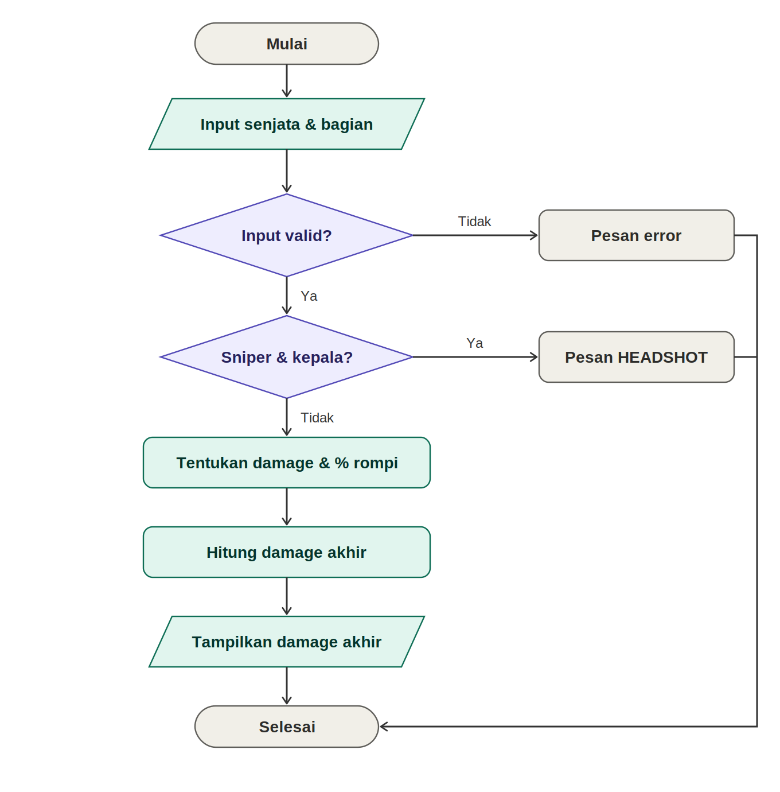

# UJIAN TENGAH SEMESTER - DASAR PEMROGRAMAN

**Identitas Mahasiswa:**

- **Nama:** Fabianugerah Bainasshiddiq
- **NIM:** 264107020026
- **Kelas / No. Presensi:** 1D / 14

---

## 1: SOAL

### Soal Q5: Simulasi Damage Akhir Tembakan (Free Fire)

Tim pengembang ingin membuat simulasi untuk menghitung damage akhir satu tembakan ke musuh berdasarkan:

- Jenis senjata: AR, SMG, atau Sniper
- Bagian tubuh yang terkena: kepala atau badan

Setiap kombinasi memiliki damage dasar berbeda. Musuh diasumsikan memakai rompi level 2 yang mengurangi damage.

**Damage dasar per tembakan:**

| Senjata | Bagian Tubuh | Damage Dasar |
| :-: | :-: | :-: |
| AR | kepala | 60 |
| AR | badan | 35 |
| SMG | kepala | 45 |
| SMG | badan | 25 |
| Sniper | kepala | knock langsung |
| Sniper | badan | 90 |

**Aturan pengurangan oleh rompi:**

- **AR:** damage berkurang 20% hanya jika mengenai badan.
- **SMG:** damage berkurang 30% untuk semua bagian tubuh.
- **Sniper:** tidak terpengaruh rompi. Jika bagian = kepala, tampilkan `"HEADSHOT! Musuh langsung knock."`
- Jika input tidak valid, tampilkan `"Input tidak valid. Pastikan senjata = (AR/SMG/Sniper) dan bagian = (kepala/badan)."`

**Contoh eksekusi:**

```
Senjata (AR/SMG/Sniper): AR
Bagian tubuh (kepala/badan): badan
Damage dasar: 35
Pengurangan rompi: 20% (7)
Damage akhir: 28
```

---

## 2: HASIL PENGERJAAN & ANALISIS

### 2.1 Flowchart Soal Q5



### 2.2 Kode Program Java

```java
// NAMA : FABIANUGERAH BAINASSHIDDIQ
// NIM : 264107020026
// KELAS : TI - 1D
import java.util.Scanner;

public class uts14 {
    public static void main(String[] args) {
        Scanner sc = new Scanner(System.in);

        String jenisSenjata, bagianTubuh;

        System.out.print("Senjata (AR/SMG/Sniper): ");
        jenisSenjata = sc.nextLine();
        System.out.print("Bagian Tubuh (kepala/badan): ");
        bagianTubuh = sc.nextLine();

        boolean senjataValid, bagianValid;

        senjataValid = jenisSenjata.equalsIgnoreCase("AR") || jenisSenjata.equalsIgnoreCase("SMG") || jenisSenjata.equalsIgnoreCase("Sniper");
        bagianValid = bagianTubuh.equalsIgnoreCase("kepala") || bagianTubuh.equalsIgnoreCase("badan");


        if (!senjataValid || !bagianValid) {
            System.out.println("Input tidak valid. Pastikan senjata = (AR/SMG/Sniper) dan bagian = (kepala/badan).");
        } else if (jenisSenjata.equalsIgnoreCase("Sniper") && bagianTubuh.equalsIgnoreCase("kepala")) {
            System.out.println("HEADSHOT! Musuh langsung knock.");
        } else {
            int damageDasar;
            int persenRompi;

            if (jenisSenjata.equalsIgnoreCase("AR")) {
                if (bagianTubuh.equalsIgnoreCase("kepala")) {
                    damageDasar = 60;
                    persenRompi = 0;
                } else {
                    damageDasar = 35;
                    persenRompi = 20;
                }
            } else if (jenisSenjata.equalsIgnoreCase("SMG")) {
                persenRompi = 30;
                if (bagianTubuh.equalsIgnoreCase("kepala")) {
                    damageDasar = 45;
                } else {
                    damageDasar = 25;
                }
            } else {
                damageDasar = 90;
                persenRompi = 0;
            }

            double pengurangan = damageDasar * persenRompi / 100.0;
            double damageAkhir = damageDasar - pengurangan;

            System.out.println("Damage dasar: " + damageDasar);
            System.out.println("Pengurangan rompi: " + persenRompi + "% (" + pengurangan + ")");
            System.out.println("Damage akhir: " + damageAkhir);
        }

        sc.close();
    }
}
```

### 2.3 Tabel Pengujian

| Uji | Senjata | Bagian | Damage Dasar | Pengurangan Rompi | Damage Akhir / Output |
| :-: | :-: | :-: | :-: | :-: | :-- |
| 1 | AR | kepala | 60 | 0% | 60.0 |
| 2 | AR | badan | 35 | 20% (7.0) | 28.0 |
| 3 | SMG | kepala | 45 | 30% (13.5) | 31.5 |
| 4 | SMG | badan | 25 | 30% (7.5) | 17.5 |
| 5 | Sniper | kepala | - | - | HEADSHOT! Musuh langsung knock. |
| 6 | Sniper | badan | 90 | 0% | 90.0 |
| 7 | Pistol | kepala | - | - | Input tidak valid. Pastikan senjata = (AR/SMG/Sniper) dan bagian = (kepala/badan). |

### 2.4 Penjelasan Program

- **Validasi input:** `senjataValid` dan `bagianValid` memakai operator `||` dengan `equalsIgnoreCase`, sehingga huruf besar/kecil tidak berpengaruh. Jika salah satunya tidak valid, program menampilkan pesan input tidak valid.
- **Kasus khusus Sniper kepala:** diperiksa lebih dulu dengan `&&` karena tidak ada damage dasar, hanya pesan headshot.
- **Damage dasar dan persen rompi:** ditentukan dengan `nested if` berdasarkan senjata, lalu bagian tubuh. AR kepala dan Sniper badan tidak dikurangi rompi (`persenRompi = 0`).
- **Perhitungan:** `pengurangan = damageDasar * persenRompi / 100.0`, lalu `damageAkhir = damageDasar - pengurangan`.

---

## 3: KESIMPULAN

Program berhasil menghitung damage akhir satu tembakan berdasarkan jenis senjata dan bagian tubuh. Validasi input dengan operator logika memastikan hanya kombinasi yang valid yang diproses, dan `nested if` dipakai untuk menentukan damage dasar serta pengurangan rompi untuk tiap senjata.