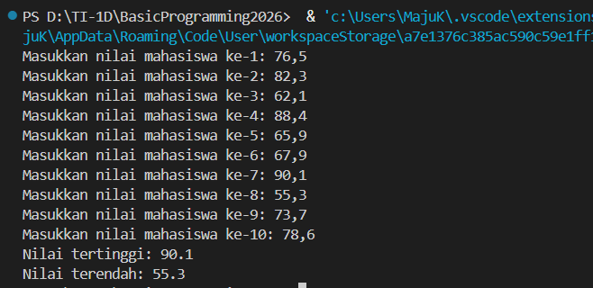
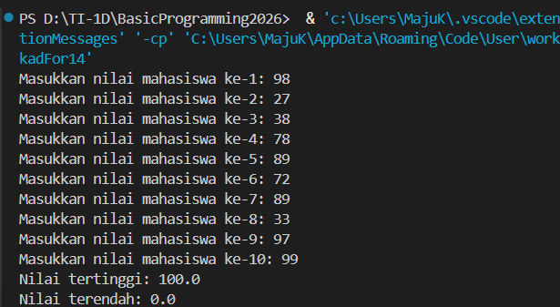
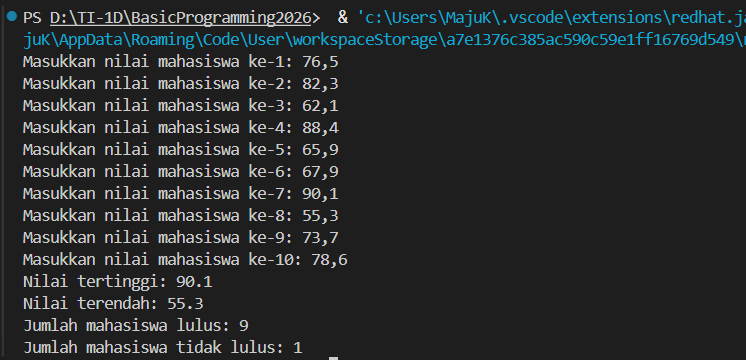
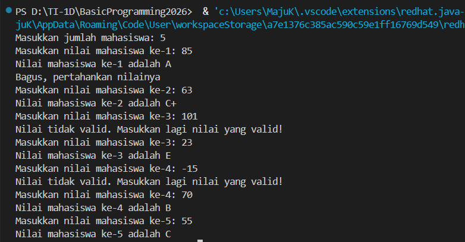
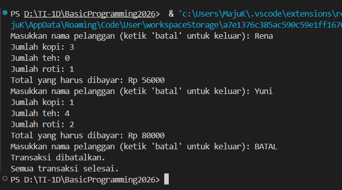
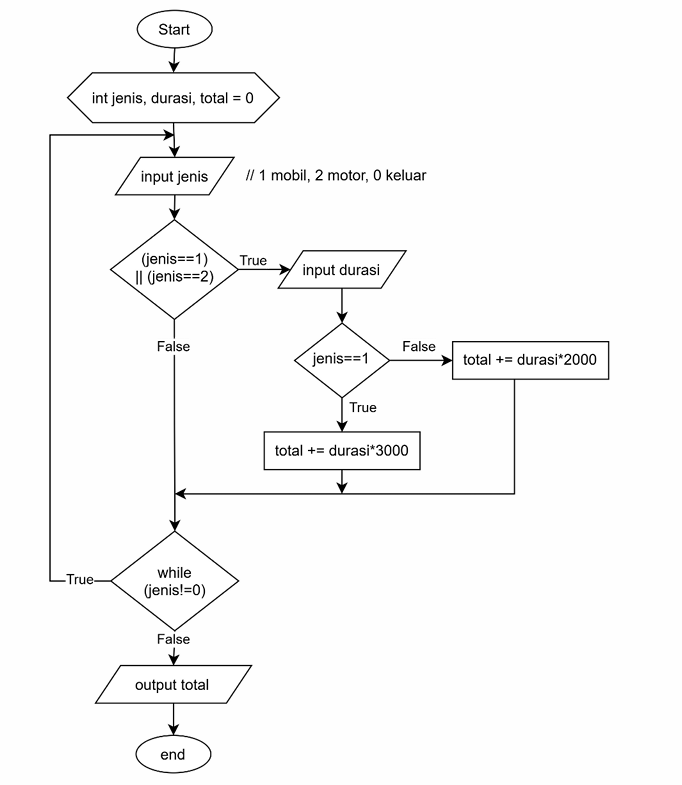
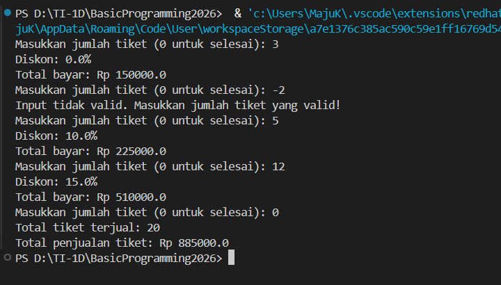
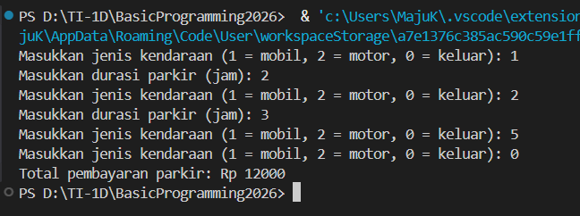

# JOBSHEET 7 - PERULANGAN 1

**Identitas Mahasiswa:**

- **Nama:** Fabianugerah Bainasshiddiq
- **NIM:** 264107020026
- **Kelas / No. Presensi:** 1D / 14

---

## 1: TUJUAN PRAKTIKUM

Berikut adalah tujuan pelaksanaan praktikum pada bab ini:

1. Mahasiswa dapat menjelaskan format penulisan program perulangan (`for`, `while`, dan `do-while`).
2. Mahasiswa dapat mengimplementasikan flowchart perulangan menggunakan bahasa pemrograman Java.

---

## 2: HASIL PERCOBAAN & ANALISIS

### 2.1 Percobaan 1: Studi Kasus Nilai Mahasiswa di SIAKAD - Perulangan FOR

Pada percobaan ini, dosen ingin mencari nilai tertinggi dan terendah Kuis dari 10 mahasiswa dalam satu kelas. Program memakai perulangan `for` untuk memasukkan nilai setiap mahasiswa, lalu menampilkan nilai tertinggi dan terendah.

#### 2.1.1 Kode Program Java

```java
import java.util.Scanner;

public class SiakadFor14 {
    public static void main(String[] args) {
        Scanner sc = new Scanner(System.in);

        double nilai, tertinggi = 0, terendah = 100;

        for (int i = 1; i <= 10; i++) {
            System.out.print("Masukkan nilai mahasiswa ke-" + i + ": ");
            nilai = sc.nextDouble();
            if (nilai > tertinggi) {
                tertinggi = nilai;
            }
            if (nilai < terendah) {
                terendah = nilai;
            }
        }

        System.out.println("Nilai tertinggi: " + tertinggi);
        System.out.println("Nilai terendah: " + terendah);

        sc.close();

    }
}
```

#### 2.1.2 Hasil Running / Screenshot Output

Berikut adalah tampilan _output_ setelah program dijalankan:



#### 2.1.3 Jawaban Pertanyaan / Pertanyaan Refleksi

- **Pertanyaan 1:** Sebutkan dan tunjukkan masing-masing komponen perulangan FOR pada kode program Percobaan 1!
  - **Jawab:** Pada `for (int i = 1; i <= 10; i++)`, komponennya adalah:
    - **Inisialisasi:** `int i = 1`, nilai awal variabel pencacah.
    - **Kondisi:** `i <= 10`, perulangan berjalan selama kondisi ini `true`.
    - **Update:** `i++`, menambah nilai `i` satu setiap akhir putaran.
    - **Badan perulangan:** blok `{ ... }` yang berisi input nilai dan pemeriksaan nilai tertinggi, terendah, serta lulus atau tidak lulus.

- **Pertanyaan 2:** Mengapa variabel `tertinggi` diinisialisasi 0 dan `terendah` diinisialisasi 100? Apa yang terjadi jika `tertinggi` diinisialisasi 100 dan `terendah` diinisialisasi 0?
  - **Jawab:** Nilai mahasiswa berada pada rentang 0 sampai 100. Dengan `tertinggi = 0`, nilai pertama yang masuk pasti lebih besar atau sama dengan 0 sehingga bisa menggantikannya. Dengan `terendah = 100`, nilai pertama pasti kurang dari atau sama dengan 100 sehingga bisa menggantikannya. Jika dibalik (`tertinggi = 100` dan `terendah = 0`), kondisi `nilai > tertinggi` dan `nilai < terendah` tidak pernah bernilai `true` untuk nilai 0-100, sehingga hasilnya selalu salah: `tertinggi` tetap 100 dan `terendah` tetap 0.

  - **Output Program:**

    

- **Pertanyaan 3:** Jelaskan fungsi dan alur kerja dari potongan kode berikut!

  ```java
  if (nilai > tertinggi) {
      tertinggi = nilai;
  }
  if (nilai < terendah) {
      terendah = nilai;
  }
  ```

  - **Jawab:** Dua `if` terpisah ini dijalankan pada setiap putaran. `if` pertama membandingkan nilai yang baru dimasukkan dengan `tertinggi`, dan jika lebih besar maka `tertinggi` diganti dengan nilai tersebut. `if` kedua membandingkan nilai dengan `terendah`, dan jika lebih kecil maka `terendah` diganti. Keduanya dibuat terpisah (bukan `else if`) karena kedua pengecekan harus selalu dilakukan. Setelah 10 putaran, `tertinggi` dan `terendah` berisi nilai terbesar dan terkecil.

- **Pertanyaan 4:** Modifikasi kode program untuk menentukan berapa mahasiswa yang lulus dan tidak lulus berdasarkan batas kelulusan (nilai minimal 60)!
  - **Jawab:** Ditambahkan variabel `lulus` dan `tidakLulus` bernilai awal 0. Di dalam perulangan, `if (nilai >= 60)` menambah `lulus`, selain itu menambah `tidakLulus`. Jumlah keduanya ditampilkan setelah nilai tertinggi dan terendah.
  - **Kode Program:**

  ```java
    import java.util.Scanner;

    public class SiakadFor14 {
        public static void main(String[] args) {
            Scanner sc = new Scanner(System.in);

            double nilai, tertinggi = 0, terendah = 100;
            int lulus = 0, tidakLulus = 0;

            for (int i = 1; i <= 10; i++) {
                System.out.print("Masukkan nilai mahasiswa ke-" + i + ": ");
                nilai = sc.nextDouble();
                if (nilai > tertinggi) {
                    tertinggi = nilai;
                }
                if (nilai < terendah) {
                    terendah = nilai;
                }
                if (nilai >= 60) {
                    lulus++;
                } else {
                    tidakLulus++;
                }
            }

            System.out.println("Nilai tertinggi: " + tertinggi);
            System.out.println("Nilai terendah: " + terendah);
            System.out.println("Jumlah mahasiswa lulus: " + lulus);
            System.out.println("Jumlah mahasiswa tidak lulus: " + tidakLulus);

            sc.close();
        }
    }
  ```

  - **Output Program:**

    

---

### 2.2 Percobaan 2: Studi Kasus Nilai Mahasiswa di SIAKAD - Perulangan WHILE

Percobaan ini menggunakan perulangan `while` untuk menerima nilai sejumlah mahasiswa. Nilai tidak valid (negatif atau lebih dari 100) diabaikan dan input diulang, sedangkan nilai valid dikelompokkan ke kategori huruf A (80 < nilai <= 100), B+ (73 < nilai <= 80), B (65 < nilai <= 73), C+ (60 < nilai <= 65), C (50 < nilai <= 60), D (39 < nilai <= 50), dan E (nilai <= 39).

#### 2.2.1 Kode Program Java

```java
import java.util.Scanner;

public class SiakadWhile14 {
    public static void main(String[] args) {
        Scanner sc = new Scanner(System.in);

        int nilai, jml, i = 0;

        System.out.print("Masukkan jumlah mahasiswa: ");
        jml = sc.nextInt();

        while (i < jml) {
            System.out.print("Masukkan nilai mahasiswa ke-" + (i + 1) + ": ");
            nilai = sc.nextInt();

            if (nilai < 0 || nilai > 100) {
                System.out.println("Nilai tidak valid. Masukkan lagi nilai yang valid!");
                continue;
            }

            if (nilai > 80 && nilai <= 100) {
                System.out.println("Nilai mahasiswa ke-" + (i + 1) + " adalah A");
                System.out.println("Bagus, pertahankan nilainya");
            } else if (nilai > 73 && nilai <= 80) {
                System.out.println("Nilai mahasiswa ke-" + (i + 1) + " adalah B+");
            } else if (nilai > 65 && nilai <= 73) {
                System.out.println("Nilai mahasiswa ke-" + (i + 1) + " adalah B");
            } else if (nilai > 60 && nilai <= 65) {
                System.out.println("Nilai mahasiswa ke-" + (i + 1) + " adalah C+");
            } else if (nilai > 50 && nilai <= 60) {
                System.out.println("Nilai mahasiswa ke-" + (i + 1) + " adalah C");
            } else if (nilai > 39 && nilai <= 50) {
                System.out.println("Nilai mahasiswa ke-" + (i + 1) + " adalah D");
            } else {
                System.out.println("Nilai mahasiswa ke-" + (i + 1) + " adalah E");
            }
            i++;
        }

        sc.close();
    }
}
```

#### 2.2.2 Tabel Pengujian Parameter Output

Berikut adalah hasil uji coba program dengan jumlah mahasiswa 5:

| Uji | Input Nilai |        Status Eksekusi        |
| :-: | :---------: | :---------------------------: |
|  1  |    `85`     | Kategori A dan  pesan `"Bagus, pertahankan nilainya"` |
|  2  |    `63`     |          Kategori C+          |
|  3  |    `101`    | Nilai tidak valid. Masukkan lagi nilai yang valid! |
|  4  |    `23`     |          Kategori E           |
|  5  |    `-15`    | Nilai tidak valid. Masukkan lagi nilai yang valid! |
|  6  |    `70`     |          Kategori B           |
|  7  |    `55`     |          Kategori C           |

#### 2.2.3 Hasil Running / Screenshot Output

Berikut adalah tampilan _output_ setelah program dijalankan:



#### 2.2.4 Jawaban Pertanyaan / Pertanyaan Refleksi

- **Pertanyaan 1:** Pada potongan kode berikut, tentukan maksud dan kegunaan dari sintaks berikut:

    ```java
    if (nilai < 0 || nilai > 100) {
        System.out.println("Nilai tidak valid. Masukkan lagi nilai yang valid!");
        continue;
    }
    ```

    **a. nilai < 0 || nilai > 100**
    **b. continue**

  - **Jawab:**
    - `nilai < 0 || nilai > 100`: bernilai `true` jika nilai di bawah 0 atau di atas 100, artinya nilai berada di luar rentang valid 0-100. Operator `|| (OR)` dipakai karena cukup salah satu nilai `true` agar nilai dianggap tidak valid.
    - `continue`: melewati sisa perintah di dalam badan perulangan pada putaran itu dan kembali ke pengecekan kondisi `while`. Karena `i++` berada di akhir dan ikut terlewati, nilai `i` tidak bertambah sehingga program meminta input nilai mahasiswa lagi yang valid.

- **Pertanyaan 2:** Mengapa sintaks `i++` dituliskan di akhir perulangan WHILE? Apa yang terjadi jika posisinya dituliskan di awal perulangan WHILE?
  - **Jawab:** `i++` di akhir memastikan `i` hanya bertambah setelah nilai valid selesai diproses, dan karena `continue` melewatinya, input tidak valid tidak menggeser ke mahasiswa berikutnya. Jika `i++` ditulis di awal, `i` bertambah sebelum nilai diperiksa sehingga nomor mahasiswa pada tampilan bergeser (mulai dari ke-2) dan nilai tidak valid tetap menghabiskan satu putaran. Akibatnya jumlah nilai valid yang diproses bisa kurang dari `jml`.

- **Pertanyaan 3:** Apabila jumlah mahasiswa yang dimasukkan adalah 19, berapa kali perulangan WHILE akan berjalan?
  - **Jawab:** `i` dimulai dari 0 dan perulangan berhenti saat `i < 19` tidak terpenuhi, yaitu `i` = 0 sampai 18, sehingga perulangan berjalan 19 kali jika semua nilai valid. Setiap input tidak valid menambah satu putaran karena `i` tidak bertambah.

- **Pertanyaan 4:** Modifikasi kode program sehingga apabila terdapat mahasiswa yang mendapat nilai A, program menampilkan pesan tambahan "Bagus, pertahankan nilainya"!
  - **Jawab:** Pada blok `if (nilai > 80 && nilai <= 100)` ditambahkan satu baris `System.out.println("Bagus, pertahankan nilainya");` **(lihat kode pada 2.2.1 dan output pada 2.2.3)**.

---

### 2.3 Percobaan 3: Studi Kasus Transaksi di Kafe - Perulangan DO-WHILE

Percobaan ini menggunakan perulangan `do-while` untuk memproses transaksi pelanggan di kafe dengan harga kopi Rp12.000, teh Rp7.000, dan roti Rp20.000. Kasir terus memasukkan transaksi sampai nama pelanggan yang dimasukkan adalah "batal".

#### 2.3.1 Kode Program Java

```java
import java.util.Scanner;

public class KafeDoWhile14 {
    public static void main(String[] args) {
        Scanner sc = new Scanner(System.in);

        int kopi, teh, roti, totalHarga;
        String namaPelanggan;
        int hargaKopi = 12000, hargaTeh = 7000, hargaRoti = 20000;

        do {
            System.out.print("Masukkan nama pelanggan (ketik 'batal' untuk keluar): ");
            namaPelanggan = sc.nextLine();
            if (namaPelanggan.equalsIgnoreCase("batal")) {
                System.out.println("Transaksi dibatalkan.");
                break;
            }
            System.out.print("Jumlah kopi: ");
            kopi = sc.nextInt();
            System.out.print("Jumlah teh: ");
            teh = sc.nextInt();
            System.out.print("Jumlah roti: ");
            roti = sc.nextInt();

            totalHarga = (kopi * hargaKopi) + (teh * hargaTeh) + (roti * hargaRoti);
            System.out.println("Total yang harus dibayar: Rp " + totalHarga);
            sc.nextLine();
        } while (true);

        System.out.println("Semua transaksi selesai.");

        sc.close();
    }
}
```

#### 2.3.2 Tabel Pengujian Parameter Output

Berikut adalah hasil uji coba program dengan beberapa masukan:

| Uji | Nama Pelanggan | Kopi | Teh | Roti |            Status Eksekusi            |
| :-: | :------------: | :--: | :-: | :--: | :-----------------------------------: |
|  1  |     `Rena`     |  3   |  0  |  1   | Total yang harus dibayar: Rp 56000 |
|  2  |     `Yuni`     |  1   |  4  |  2   | Total yang harus dibayar: Rp 80000 |
|  3  |    `BATAL`     |  -   |  -  |  -   | Transaksi dibatalkan, perulangan berhenti |

#### 2.3.3 Hasil Running / Screenshot Output

Berikut adalah tampilan _output_ setelah program dijalankan:



#### 2.3.4 Jawaban Pertanyaan / Pertanyaan Refleksi

- **Pertanyaan 1:** Pada penggunaan DO-WHILE ini, apabila nama pelanggan yang dimasukkan pertama kali adalah "batal", maka berapa kali perulangan dilakukan?
  - **Jawab:** **Satu kali.** Pada `do-while`, badan perulangan dijalankan lebih dulu sebelum kondisi dicek. Nama "batal" langsung terdeteksi oleh `if`, lalu `break` menghentikan perulangan pada putaran pertama itu.

- **Pertanyaan 2:** Sebutkan kondisi berhenti yang digunakan pada perulangan DO-WHILE tersebut!
  - **Jawab:** Perulangan berhenti ketika `namaPelanggan.equalsIgnoreCase("batal")` bernilai `true`, lalu `break` dijalankan. Kondisi `while (true)` sendiri tidak pernah menghentikan perulangan.

- **Pertanyaan 3:** Apa fungsi dari penggunaan nilai `true` pada kondisi DO-WHILE?
  - **Jawab:** Membuat kondisi perulangan selalu terpenuhi sehingga perulangan berjalan terus (perulangan tak hingga) sampai dihentikan oleh `break` dari dalam badan perulangan.

- **Pertanyaan 4:** Mengapa perulangan DO-WHILE tersebut tetap berjalan meskipun tidak ada komponen inisialisasi dan update?
  - **Jawab:** Karena `do-while` hanya membutuhkan kondisi. Inisialisasi dan update hanya diperlukan jika perulangan dikendalikan oleh variabel pencacah. Di sini kondisi selalu `true` dan penghentiannya dikendalikan oleh masukan pengguna melalui `break`, sehingga tidak ada pencacah yang perlu diinisialisasi atau di-update.

---

## 4: TUGAS MANDIRI

Berikut adalah daftar tugas yang dikerjakan pada Jobsheet ini:

- [x] **Tugas 1:** Seorang pengelola bioskop ingin membuat program untuk menghitung total penjualan tiket dalam satu hari. Tiket dijual dengan harga `Rp 50.000` per tiket. Program harus menghitung total tiket yang terjual dan total harga penjualan tiket selama satu hari dengan ketentuan sebagai berikut:
- Jika pelanggan membeli lebih dari 4 tiket, pelanggan mendapatkan diskon 10%.
- Jika pelanggan membeli lebih dari 10 tiket, pelanggan mendapatkan diskon 15%.
- Jika input jumlah tiket tidak valid (negatif), program akan mengabaikan input tersebut dan meminta input ulang.
- [x] **Tugas 2:** Perhatikan flowchart berikut!

    

Sebuah tempat parkir ingin membuat program untuk menghitung total pembayaran parkir dari beberapa kendaraan. Tarif parkir adalah `Rp 3.000` per jam untuk mobil dan `Rp 2.000` per jam untuk motor. Program akan terus meminta masukan selama input bukan 0. Implementasikan flowchart tersebut ke dalam bentuk kode program Java!

### 4.1 Tugas 1: Total Penjualan Tiket Bioskop

Program menghitung diskon dan total bayar setiap pelanggan, lalu menjumlahkan total tiket dan total penjualan selama satu hari. Perulangan memakai `while (true)` dengan `continue` untuk input negatif. Karena soal tidak menentukan cara mengakhiri input, program berhenti ketika jumlah tiket yang dimasukkan adalah 0.

#### 4.1.1 Kode Program Java

```java
import java.util.Scanner;

public class Tugas1TiketBioskop14 {
    public static void main(String[] args) {
        Scanner sc = new Scanner(System.in);

        int hargaTiket = 50000;
        int jumlahTiket, totalTiket = 0;
        double totalHarga, diskon, totalPenjualan = 0;

        while (true) {
            System.out.print("Masukkan jumlah tiket (0 untuk selesai): ");
            jumlahTiket = sc.nextInt();

            if (jumlahTiket < 0) {
                System.out.println("Input tidak valid. Masukkan jumlah tiket yang valid!");
                continue;
            }
            if (jumlahTiket == 0) {
                break;
            }

            diskon = 0;
            if (jumlahTiket > 10) {
                diskon = 15;
            } else if (jumlahTiket > 4) {
                diskon = 10;
            }

            totalHarga = jumlahTiket * hargaTiket * (100 - diskon) / 100;
            System.out.println("Diskon: " + diskon + "%");
            System.out.println("Total bayar: Rp " + (totalHarga));

            totalTiket += jumlahTiket;
            totalPenjualan += totalHarga;
        }

        System.out.println("Total tiket terjual: " + totalTiket);
        System.out.println("Total penjualan tiket: Rp " + totalPenjualan);

        sc.close();
    }
}
```

#### 4.1.2 Tabel Pengujian Parameter Output

| Uji | Jumlah Tiket | Diskon | Total Bayar | Status Eksekusi |
| :---: | :---: | :---: | :---: | :---: |
| 1 | 3 | 0% | Rp150.000 | Dihitung tanpa diskon |
| 2 | -2 | - | - | Input tidak valid, diminta ulang |
| 3 | 5 | 10% | Rp225.000 | Dihitung dengan diskon 10% |
| 4 | 12 | 15% | Rp510.000 | Dihitung dengan diskon 15% |
| 5 | 0 | - | - | Selesai: total tiket 20, total penjualan tiket Rp885.000 |

#### 4.1.3 Hasil Running / Screenshot Output

Berikut adalah tampilan _output_ setelah program dijalankan:



### 4.2 Tugas 2: Pembayaran Parkir (Implementasi Flowchart)

Program mengimplementasikan flowchart parkir dengan perulangan `do-while`. Program meminta jenis kendaraan (1 = mobil, 2 = motor, 0 = keluar). Jika jenisnya 1 atau 2, program meminta durasi lalu menambahkan biaya ke total. Perulangan berhenti saat jenis bernilai 0.

#### 4.2.1 Kode Program Java

```java
import java.util.Scanner;

public class Tugas2Parkir14 {
    public static void main(String[] args) {
        Scanner sc = new Scanner(System.in);

        int jenis, durasi, total = 0;

        do {
            System.out.print("Masukkan jenis kendaraan (1 = mobil, 2 = motor, 0 = keluar): ");
            jenis = sc.nextInt();

            if (jenis == 1 || jenis == 2) {
                System.out.print("Masukkan durasi parkir (jam): ");
                durasi = sc.nextInt();

                if (jenis == 1) {
                    total += durasi * 3000;
                } else {
                    total += durasi * 2000;
                }
            }
        } while (jenis != 0);

        System.out.println("Total pembayaran parkir: Rp " + total);
        
        sc.close();
    }
}
```

#### 4.2.2 Tabel Pengujian Parameter Output

| Uji | Jenis | Durasi (jam) | Tambahan Total | Status Eksekusi |
| :---: | :---: | :---: | :---: | :---: |
| 1 | `1` (mobil) | 2 | Rp6.000 | Biaya mobil ditambahkan |
| 2 | `2` (motor) | 3 | Rp6.000 | Biaya motor ditambahkan |
| 3 | `5` | - | Rp0 | Jenis tidak dikenali, diabaikan |
| 4 | `0` | - | - | Perulangan berhenti, total Rp12.000 |

#### 4.2.3 Hasil Running / Screenshot Output

Berikut adalah tampilan _output_ setelah program dijalankan:



---

## 5: KESIMPULAN

Berdasarkan hasil praktikum Jobsheet 7 tentang Perulangan 1, dapat disimpulkan bahwa:

1. **Perulangan `for`** cocok dipakai ketika jumlah putaran sudah diketahui. Komponennya terdiri dari inisialisasi, kondisi, dan update, seperti pada pencarian nilai tertinggi dan terendah dari 10 mahasiswa pada Percobaan 1.

2. **Perulangan `while`** mengecek kondisi sebelum badan perulangan dijalankan. Bersama `continue`, perulangan ini dapat dipakai untuk mengulang input yang tidak valid tanpa menambah pencacah, seperti pada Percobaan 2.

3. **Perulangan `do-while`** menjalankan badan perulangan minimal satu kali karena kondisi dicek di akhir. Dengan kondisi `true` dan `break`, perulangan dapat dihentikan berdasarkan masukan pengguna, seperti pada Percobaan 3 dan Tugas 2.

4. **Pemilihan jenis perulangan** bergantung pada kasusnya: `for` untuk jumlah putaran yang pasti, `while` untuk perulangan bersyarat, dan `do-while` ketika proses harus dijalankan setidaknya sekali. Perulangan juga dapat digabung dengan pemilihan (`if`) untuk memproses data berulang sekaligus menyaring input.
